## Vinte barris para duas gerações

::: {.no-bullet}
Um poço tem 20 barris de petróleo e deve servir a duas gerações. Sem
limite de estoque, cada geração extrairia 15. A taxa de juros é de 10%
por geração. Como uma alocação **eficiente** divide os 20 barris?
:::

::: {.opcoes}
**(a)** 10 barris para cada geração.

**(b)** Mais de 10 barris para a geração presente.

**(c)** Mais de 10 barris para a geração futura.
:::

::: {.no-bullet}
E essa divisão é **justa**?
:::

## Aula Passada

- Bens com qualidade diferenciada
  - Distribuição Observada
- Modelo de Preços Hedônicos
  - Premissas
  - Demanda
  - Oferta
  - Pontos de Equilíbrio
- Estimando Disposição Marginal a Pagar
  - Modelo Econométrico
  - Aplicações

::: {.no-bullet}
Referência: Phaneuf e Requate, caps. 15 e 18
:::

## Agenda

:::: {.columns}
::: {.column width="52%"}
- Economia dos Recursos Naturais
- Eficiência Dinâmica e Equidade
  - Eficiência Dinâmica
  - Custo Marginal da Escassez
  - Equidade
- Sustentabilidade
  - Critério da Sustentabilidade
  - Exemplo: Fundo Permanente do Alasca
  - Critérios Alternativos
- Implicação para Política Pública
:::

::: {.column width="48%"}
- Taxonomia dos Recursos Não-Renováveis
- Reciclagem
- Alocação Intertemporal
  - Sem Substitutos
  - Com Substitutos
  - Custo Marginal Crescente
  - Recurso Parcialmente Renovável
:::
::::

::: {.no-bullet}
Referência: Tietenberg e Lewis, caps. 5 e 6
:::

## Onde estamos no curso

:::::: step-map
::: step
**1. Poluição.** Externalidade em um único período: a emissão de hoje
não altera o que existe amanhã.
:::

::: step
**2. Valoração.** Como medir em reais o dano marginal do bem ambiental.
:::

::: {.step .now}
**3. Recursos naturais.** O tempo entra no problema: o que se extrai
hoje deixa de existir amanhã.
:::

::: {.step .now}
**4. Duas perguntas:** qual alocação entre gerações é eficiente? Qual é
justa?
:::
::::::

## Economia dos Recursos Naturais {.section-cover}

## Economia dos Recursos Naturais

- Até agora, estudamos externalidades ambientais negativas, suas causas e
  potenciais soluções.
- Nas próximas aulas, trataremos da exploração de recursos naturais.
  - E potenciais problemas quando essa exploração é feita de maneira
    ineficiente.
- Vamos passar a falar de um problema similar ao de **recursos comuns**.

## Economia dos Recursos Naturais {style="font-size:0.94em"}

- Um aspecto relevante para recursos naturais, que ignoramos no caso de
  poluição, é o **tempo**.
- Muitos recursos naturais são classificados como **não-renováveis**.
  - Isso significa que a exploração desses recursos **hoje** impacta o
    quanto estará disponível **amanhã**.
  - **Exemplo: petróleo.**
    - As reservas de petróleo se formaram ao longo de milhões de anos e
      são finitas.
    - Quanto mais se explora hoje, menos haverá amanhã.
- Mesmo no caso de **recursos renováveis**, há um **tempo de
  reposição.**
  - **Exemplo: extração de madeira.**
    - Árvores com valor comercial demoram alguns anos para amadurecer.
    - Se o produtor corta as árvores rápido demais, ficará sem matéria
      prima até que novas mudas cresçam o suficiente.

## Eficiência Dinâmica e Equidade {.section-cover}

## Eficiência Dinâmica e Equidade

- Nas aulas anteriores, tratamos de **eficiência estática.**
  - Ou seja, a dimensão tempo não era relevante.
- O conceito de **eficiência dinâmica** diz respeito à alocação
  intertemporal de consumo ou recursos.
  - Nos cursos de Micro e Macro, vocês devem ter estudado **suavização de
    consumo** em um modelo intertemporal, por exemplo.
- Eficiência dinâmica diz respeito ao uso de recursos sem desperdício.
  - Assim como a ideia de **Pareto-Ótimo** vista anteriormente.

## Eficiência Dinâmica e Equidade

- O uso sem desperdício, no entanto, pode não ser a única preocupação da
  nossa sociedade.
- Muitas vezes, queremos que a distribuição de recursos também seja
  justa.
  - Este é o critério de **equidade.**
- Assim, no caso de recursos naturais, podemos querer **distribuições
  eficientes ou justas entre gerações**.

## Exemplo "Moderno"

:::: {.columns}
::: {.column width="48%"}
::: {.no-bullet}
Mar de Aral era 4º maior lago do mundo, mas praticamente secou ao longo
de 20 anos.
:::

- Projeto de irrigação nos anos 60 desviou água dos rios Syr Darya e Amu
  Darya na Ásia Central.
- Embora tenha beneficiado agricultura, o desvio reduziu vazão no mar.
:::

::: {.column width="52%"}
::: {.diagram}
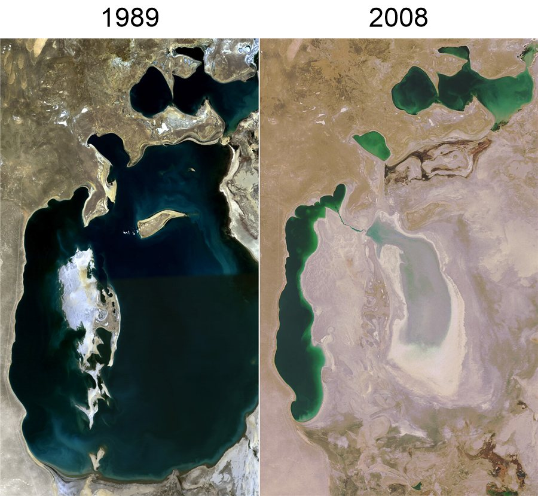{style="height:500px;max-height:500px;max-width:100%"}
:::

::: {.fonte}
Imagens: NASA (domínio público).
:::
:::
::::

## Exemplo Mais Moderno

- Pantanal **perdeu 29% da área alagada** em período de cheia (35% em
  período de seca) ao longo de 30 anos.
  - Processo está associado à perda de vegetação nas cabeceiras dos rios,
    represamento de águas e mudanças climáticas em geral no Cerrado.

::: {.diagram}
{style="height:300px;max-height:300px"}
:::

::: {.fonte}
Projeto MapBiomas: Mapeamento Anual de Cobertura e Uso da Terra no
Pantanal, Coleção 7. Licença CC BY 4.0.
[FactSheet-Pantanal_2022.pdf](https://brasil.mapbiomas.org/wp-content/uploads/sites/4/2023/11/FactSheet-Pantanal_2022.pdf)
:::

## Eficiência Dinâmica

- Os exemplos anteriores ilustram, potencialmente, as consequências de má
  gestão de recursos naturais.
  - Seja do ponto de vista de eficiência ou equidade ou ambos.
- Para começar, trataremos do conceito de eficiência dinâmica.
- Simplificaremos o problema usando um modelo de **apenas dois períodos
  de tempo.**
  - $t=1$ representa geração presente.
  - $t=2$ representa a geração futura.

## Eficiência Dinâmica

- Suponha que a demanda por determinado recurso natural seja representada
  da seguinte forma:

::: {.eq-block}
$${P}_{t}=a-b{q}_{t}$$
:::

- Sendo ${q}_{t}$ a quantidade do recurso e ${P}_{t}$ seu preço nas
  gerações $t\in \left\{1,2\right\}$.
- O custo de produção é dado por $C\left(q\right)=cq$
  - Logo, o custo marginal é dado por $CMg\left(q\right)=c$

## Eficiência Dinâmica

- Vamos representar a alocação desse recurso em cada geração $t$.
- Quantidade de equilíbrio é igual a $\frac{a-c}{b}$ nas duas gerações.
- Suponha $a=8, b=0{,}4,c=2 \to {q}_{t}=15$
- Logo, quantidade total nos dois períodos seria
  $Q={q}_{1}+{q}_{2}=30$

::: {.diagram}
[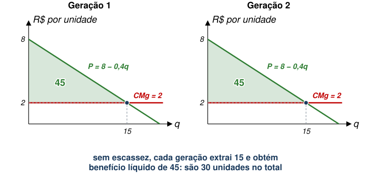{style="height:300px;max-height:300px"}]{.fragment fragment-index=1}
:::

## Eficiência Dinâmica

::: {.no-bullet}
O que está faltando neste problema?
:::

- [Escassez!]{.fragment fragment-index=1}

::: {.no-bullet}
[Se a reserva total ($\overline{Q}$) desse recurso é
$\overline{Q}\geq 30$, não há escassez.]{.fragment fragment-index=1}
:::

- [É possível consumir a quantidade ótima sem prejudicar nenhuma geração
  $t$.]{.fragment fragment-index=1}

::: {.no-bullet}
[Problema surge quando $\overline{Q}<30$.]{.fragment fragment-index=1}
:::

::: {.no-bullet}
[Com $\overline{Q}=20$, se a geração presente extrair os 15 que deseja,
restam apenas 5 para a geração futura.]{.fragment fragment-index=1}
:::

## Eficiência Dinâmica

- Como encontrar a alocação eficiente quando há escassez?
- Queremos maximizar o valor presente do benefício gerado pelo recurso.
- Qual é o benefício gerado pelo recurso em cada geração $t$?

::: {.eq-block}
[$$\text{Benefício}_{t}=\int_{0}^{{q}_{t}}\left(a-bx\right)dx=a{q}_{t}-\frac{b}{2}{q}_{t}^{2}$$]{.fragment fragment-index=1}
:::

## Eficiência Dinâmica

::: {.no-bullet}
Considerando que o custo é dado por $C\left({q}_{t}\right)=c{q}_{t}$,
qual é **o valor presente líquido do benefício gerado** em dois
períodos?
:::

::: {.eq-block}
[$$a{q}_{1}-\frac{b}{2}{q}_{1}^{2}-c{q}_{1}+\frac{1}{1+r}\left[a{q}_{2}-\frac{b}{2}{q}_{2}^{2}-c{q}_{2}\right]$$]{.fragment fragment-index=1}
:::

- [Sendo $r$ a taxa de juros]{.fragment fragment-index=1}

::: {.no-bullet}
[Qual seria a restrição neste contexto?]{.fragment fragment-index=1}
:::

::: {.eq-block}
[$${q}_{1}+{q}_{2}\leq \overline{Q}$$]{.fragment fragment-index=2}
:::

## Eficiência Dinâmica

::: {.no-bullet}
O problema de maximização seria, então,
:::

::: {.eq-block}
$$\max_{{q}_{1},{q}_{2}} \left\{a{q}_{1}-\frac{b}{2}{q}_{1}^{2}-c{q}_{1}+\frac{1}{1+r}\left[a{q}_{2}-\frac{b}{2}{q}_{2}^{2}-c{q}_{2}\right]\right\}$$
:::

::: {.eq-block}
$$\text{s.a. } {q}_{1}+{q}_{2}=\overline{Q}$$
:::

::: {.no-bullet}
Solução?
:::

## Solução por substituição

::: {.no-bullet}
Substituindo ${q}_{2}=\overline{Q}-{q}_{1}$ e derivando em relação a
${q}_{1}$:
:::

::: {.eq-block}
$$a-b{q}_{1}-c-\frac{1}{1+r}\left[a-b\left(\overline{Q}-{q}_{1}\right)-c\right]=0$$
:::

::: {.no-bullet}
[Com $a=8$, $b=0{,}4$, $c=2$, $\overline{Q}=20$ e
$r=0{,}1$:]{.fragment fragment-index=1}
:::

::: {.fragment fragment-index=1}
::: {.eq-block}
$$6-0{,}4{q}_{1}=\frac{6-0{,}4\left(20-{q}_{1}\right)}{1{,}1}\;\Rightarrow\;6{,}6-0{,}44{q}_{1}=-2+0{,}4{q}_{1}$$
:::
:::

::: {.fragment fragment-index=2}
::: {.eq-block}
$${q}_{1}^{*}=\frac{8{,}6}{0{,}84}\approx 10{,}24 \qquad {q}_{2}^{*}=20-{q}_{1}^{*}\approx 9{,}76$$
:::
:::

## Eficiência Dinâmica

::: {.no-bullet}
Alternativamente, podemos resolver o problema com
:::

::: {.eq-block}
$$\max_{{q}_{1},{q}_{2}} \left\{a{q}_{1}-\frac{b}{2}{q}_{1}^{2}-c{q}_{1}+\frac{1}{1+r}\left[a{q}_{2}-\frac{b}{2}{q}_{2}^{2}-c{q}_{2}\right]+\lambda \left[\overline{Q}-{q}_{1}-{q}_{2}\right]\right\}$$
:::

::: {.no-bullet}
E chegamos a
:::

::: {.eq-block}
$$\underbrace{a-b{q}_{1}-c}_{\substack{\text{Benefício marginal do}\\ \text{recurso em } t=1}}=\underbrace{\frac{1}{1+r}\left[a-b{q}_{2}-c\right]}_{\substack{\text{Benefício marginal em } t=2\\ \text{trazido a valor presente}}}$$
:::

## Eficiência Dinâmica {.smaller}

- Suponha mesmos valores de antes
  - $a=8, b=0{,}4, c=2$
  - Suponha também $\overline{Q}=20$ e $r=0{,}1$
- Com isso, teremos ${q}_{1}^{*}\cong 10{,}2$ e ${q}_{2}^{*}\cong 9{,}8$
- Note que recurso no futuro tem menos valor no presente por causa de
  $r$.
  - Logo, há menor alocação em $t=2$.
- Note, também, que não temos ${q}_{1}=15$ na primeira geração
  - Isto porque há um custo implícito em se explorar mais hoje → haverá
    menos amanhã.
  - Esse custo é representado por $\lambda$ (custo marginal da
    escassez).

## Custo Marginal da Escassez

::: {.no-bullet}
É o custo de oportunidade de se extrair mais recurso hoje e deixar menos
para amanhã.
:::

- Também é chamado de "Marginal User Cost".

::: {.no-bullet}
Este custo é representado por $\lambda$.
:::

- Tomemos o exemplo numérico anterior
  - $a=8;b=0{,}4; c=2; \overline{Q}=20;r=0{,}1$
  - ${q}_{1}^{*}=10{,}2;{q}_{2}^{*}=9{,}8$
  - $\lambda =1{,}9$

## O benefício marginal da geração presente

::: {.diagram}
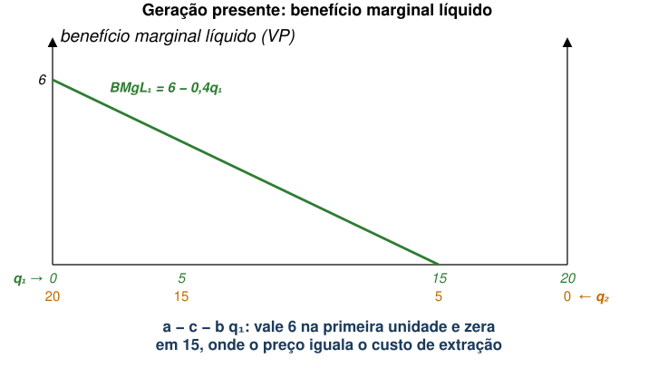{style="height:370px;max-height:370px"}
:::

- Cada ponto do eixo horizontal é uma divisão dos 20 barris: ${q}_{1}$
  cresce da esquerda, ${q}_{2}$ da direita.
- A curva verde é o ganho líquido da última unidade extraída hoje.

## Somando a geração futura

::: {.diagram}
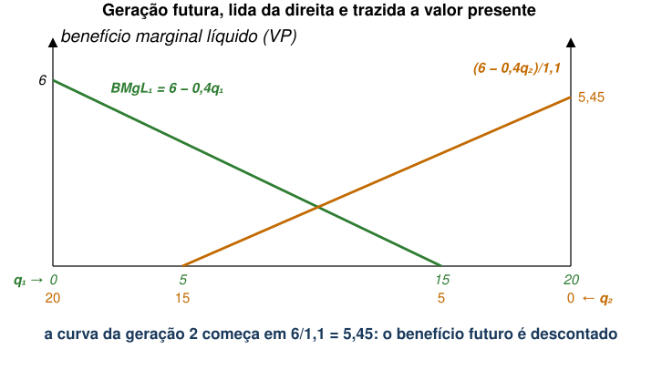{style="height:370px;max-height:370px"}
:::

- A curva laranja é o benefício marginal líquido da geração 2, em valor
  presente, lido da direita para a esquerda.
- Começa em 5,45, não em 6, por causa do desconto.

## O ótimo é o cruzamento

::: {.diagram}
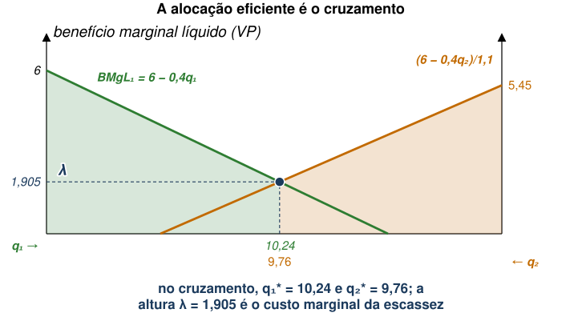{style="height:370px;max-height:370px"}
:::

- À esquerda do cruzamento, vale mais extrair hoje; à direita, amanhã.
- [Áreas sombreadas: valor presente do benefício líquido, 76,39. A
  divisão míope (15 hoje, 5 amanhã) dá 67,73.]{.fragment fragment-index=1}

## Custo Marginal da Escassez

::: {.no-bullet}
Custo marginal da escassez é crescente ao longo do tempo.
:::

- Intuitivamente, quanto mais tempo passa, menos fica para a geração
seguinte.

::: {.diagram}
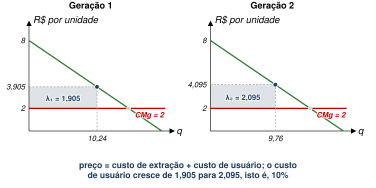{style="height:370px;max-height:370px"}
:::

## A regra de Hotelling

::: {.no-bullet}
Em cada geração, o preço é o custo de extração mais o custo de usuário:
${P}_{1}=3{,}905$ e ${P}_{2}=4{,}095$.
:::

::: {.eq-block}
$$\frac{{P}_{2}-c}{{P}_{1}-c}=\frac{2{,}095}{1{,}905}=1{,}1=1+r$$
:::

- Com custo de extração constante, o custo de usuário cresce **à taxa de
  juros** na alocação eficiente: é a regra de Hotelling
  [@hotelling1931].
- [Petróleo no subsolo é um ativo. Se a renda de escassez crescesse mais
  que $r$, ninguém extrairia hoje; se crescesse menos, todos extrairiam
  hoje e aplicariam a receita.]{.fragment fragment-index=1}
- [Em equilíbrio, manter um barril no solo rende o mesmo que vendê-lo e
  aplicar o dinheiro [@keohane2016].]{.fragment fragment-index=2}

## Quem arca com o custo de usuário?

- O dono de um poço que extrai mais hoje reduz o **próprio** estoque
  futuro. O custo de usuário recai sobre quem extrai.
- Com direitos de propriedade bem definidos, o mercado incorpora
  $\lambda$ ao preço.
- Para recursos de **acesso aberto**: a água que um usuário deixa no
  solo pode ser bombeada por outro $\rightarrow$ o custo de usuário passa a ser uma
  externalidade.
- **Aquífero de Ogallala (EUA):** cerca de 30% da água subterrânea usada
  na irrigação do país, bombeada a cerca de dez vezes a taxa de recarga
  [@keohane2016].
- Mar de Aral: quem arcava com o custo de usuário da água
  desviada?
- Problema similar ao de **recursos comuns** anunciado no início da
  aula.

## E o poder de mercado?

- Um monopolista restringe a oferta e, com recurso esgotável,
  isso significa extrair **mais devagar** que o eficiente.
- Por isso, Robert Solow chamou o monopolista de "amigo do
  conservacionista" [@keohane2016].
- [Mas mais devagar não é necessariamente melhor: o benefício líquido total fica abaixo do
  eficiente.]{.fragment fragment-index=1}
- [Caso prático: a OPEP raramente sustentou preços altos (baixa produção), pois isto estimula a
  produção fora do cartel e o descumprimento de cotas pelos membros.]{.fragment fragment-index=2}

## Equidade

::: {.no-bullet}
Conforme vimos, a geração presente deixará recursos para o futuro de
acordo com a taxa de desconto $r$
:::

::: {.no-bullet}
Se há escassez, $r$ afeta negativamente recursos em $t=2$
:::

## A taxa de desconto gira a curva da geração futura

::: {.diagram}
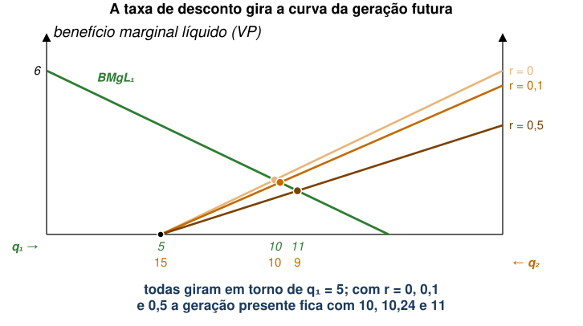{style="height:370px;max-height:370px"}
:::

- Com $r=0$, a divisão é 10 e 10. Com $r=0{,}1$, 10,24 e 9,76. Com
  $r=0{,}5$, 11 e 9.

## Equidade

::: {.no-bullet}
Conforme vimos, a geração presente deixará recursos para o futuro de
acordo com a taxa de desconto $r$
:::

::: {.no-bullet}
Se há escassez, $r$ afeta negativamente recursos em $t=2$
:::

::: {.no-bullet}
Portanto, com $r>0$, geração atual tipicamente deixa menos para o
futuro.
:::

- Mas é **justo** que seja sempre assim?

## Eficiência Dinâmica vs. Equidade

::: {.no-bullet}
O fato de que gerações passadas deixam menos recursos para gerações
futuras não parece exatamente justo.
:::

- Se isso é verdade, é preciso definir o que seria
  justo.

::: {.no-bullet}
Um critério possível que estudaremos é o de **sustentabilidade.**
:::

- Em uma alocação sustentável, **geração futura tem nível de bem-estar
  ao menos tão elevado quanto o da geração passada.**

## Critério da Sustentabilidade

::: {.no-bullet}
Assim, geração presente tem liberdade para usar recursos que não estarão disponíveis no futuro.
:::

- **Contanto que isto não prejudique bem-estar da geração futura.**

::: {.no-bullet}
Ou seja, sustentabilidade não exige que geração presente conserve
recursos não-renováveis para uso futuro.
:::

- Exige apenas que o bem-estar no futuro seja equivalente ao do
  presente.

## Critério da Sustentabilidade

::: {.no-bullet}
A pergunta que fica **é se alocações dinamicamente eficientes são
justas**
:::

::: {.no-bullet}
Consideremos o exemplo numérico anterior, com
${q}_{1}^{*}\cong 10{,}2$ e ${q}_{2}^{*}\cong 9{,}8$
:::

::: {.no-bullet}
Temos $V\left({q}_{1}^{*}\right)=40{,}4$ e
$V\left({q}_{2}^{*}\right)=39{,}6$ →
$V({q}_{1}^{*})>V({q}_{2}^{*})$
:::

- Não satisfaz sustentabilidade.

::: {.no-bullet}
Alternativamente, alocação igualitária seria sustentável:
:::

::: {.eq-block}
$${q}_{1}={q}_{2}=\overline{q}=10\to V\left(\overline{q}\right)=40 \;\forall t$$
:::

::: {.fonte}
$V(q)=aq-\frac{b}{2}q^{2}-cq$ é o benefício líquido da geração que extrai
$q$.
:::

## Eficiente contra igualitária

::: {.diagram}
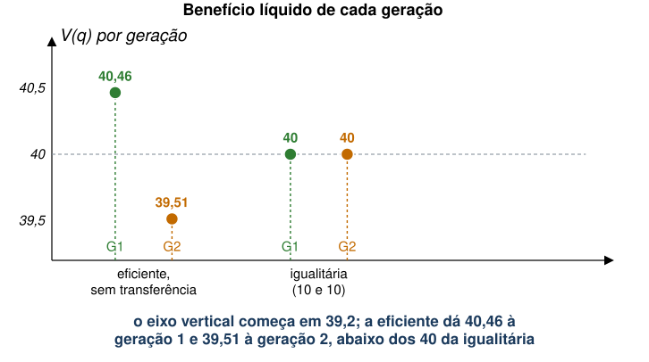{style="height:370px;max-height:370px"}
:::

- Sem arredondar ${q}_{1}^{*}=10{,}238$: $V({q}_{1}^{*})=40{,}46$ e
  $V({q}_{2}^{*})=39{,}51$.

## Critério da Sustentabilidade

::: {.no-bullet}
Mas, se geração presente pode transferir benefícios gerados para geração
futura, sustentabilidade é possível.
:::

::: {.no-bullet}
Suponha que geração presente separe uma parte de seu benefício para a
geração futura.
:::

- De modo que $V\left({\tilde{q}}_{1}\right)=V\left(\overline{q}\right)=40$

::: {.no-bullet}
Teremos uma sobra de
$\theta =V\left({q}_{1}^{*}\right)-V\left(\overline{q}\right)=0{,}4$
:::

::: {.no-bullet}
Aplicando esse valor à taxa $r=0{,}1$, geração futura terá
:::

::: {.eq-block}
$$V\left({q}_{2}^{*}\right)+\theta \left(1+r\right)=39{,}6+0{,}4\times 1{,}1=40{,}04>V\left({\tilde{q}}_{1}\right)$$
:::

- Neste caso, a alocação satisfaz o critério de sustentabilidade.

## A transferência em números

::: {.diagram}
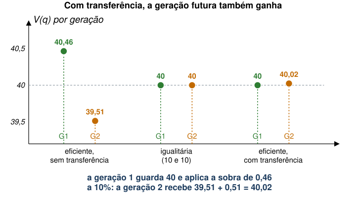{style="height:370px;max-height:370px"}
:::

- Sem arredondar valores anteriores, a sobra de 0,46 vira 0,51 e a geração 2 fica
  com 40,02: acima dos 40 da alocação igualitária.

## Critério da Sustentabilidade

::: {.no-bullet}
Portanto, eficiência dinâmica **não satisfaz sustentabilidade
automaticamente.**
:::

::: {.no-bullet}
Entretanto, introduzindo alguma regra de compartilhamento de ganhos, é
possível tornar essa alocação sustentável.
:::

## Quanto transferir? A regra de Hartwick

::: {.no-bullet}
O consumo pode ser mantido constante para sempre se **toda a renda de
escassez** do recurso extraído for investida em capital
[@hartwick1977].
:::

- Analogia: uma herança de R\$ 10.000 aplicada a 10% ao ano. Retirar até
  R\$ 1.000 por ano preserva o principal; retirar mais o esgota.
- O critério fica operacional: o **valor do estoque total de capital**
  (natural mais físico) não pode cair.
- [Não exige conhecer as preferências das gerações futuras. Basta
  acompanhar o estoque de capital ano a ano.]{.fragment
  fragment-index=1}

## Exemplo: Fundo Permanente do Alasca

::: {.no-bullet}
Extração de petróleo no Alasca (EUA) gera muitas receitas, mas tem grande
impacto ambiental.
:::

::: {.no-bullet}
Antes da conclusão do oleoduto do Alasca em 1976, governo do estado
estabeleceu um fundo permanente.
:::

- Seria alimentado com 25% de todas as receitas com a extração de
  petróleo
- Montante principal não pode ser usado para gasto corrente

::: {.no-bullet}
Fundo é aplicado em diversos investimentos.
:::

- Dividendos são, tipicamente, distribuídos entre toda a população do
  Alasca.

::: {.no-bullet}
Esta é uma política que satisfaz o critério da sustentabilidade?
:::

## Exemplo: Fundo Permanente do Alasca

::: {.no-bullet}
Esta é uma política que satisfaz o critério da sustentabilidade?
:::

- Não exatamente.

::: {.no-bullet}
Apenas 25% da receita é devolvida às gerações futuras.
:::

- Uma grande parte do ganho de bem-estar gerado fica com geração
  presente.

::: {.no-bullet}
Portanto, o fundo resolve parcialmente o problema.
:::

- Pela regra de Hartwick, a sustentabilidade plena exigiria investir 100%
da renda de escassez. 

- Em junho de 2026, o fundo valia US\$ 91,9 bilhões e, em 2025, pagou
dividendos de US\$ 1.000 a cada residente.

## Critérios alternativos

::: {.tabela}
| Critério | O que não pode cair | Substituição entre capitais |
|---|---|---|
| Sustentabilidade fraca | Valor do capital **total** (natural, físico e humano) | Ampla |
| Sustentabilidade forte | Valor do capital **natural** | Limitada |
| Sustentabilidade ambiental | **Fluxo físico** de cada recurso (ex.: captura até o crescimento do cardume) | Nenhuma |
:::

- A regra de Hartwick garante a versão **fraca**.
- [A versão fraca é a de Solow: deixar às gerações futuras a capacidade de
  estar tão bem quanto a geração atual [@keohane2016].]{.fragment
  fragment-index=1}

## Implicação para Política Pública

::: {.no-bullet}
Os conceitos de **sustentabilidade e eficiência dinâmica não são a mesma
coisa**.
:::

::: {.no-bullet}
Uma possibilidade é **buscarmos alocações sustentáveis e, dentre estas, encontrar
aquela que é dinamicamente eficiente.**
:::

::: {.no-bullet}
Podemos usar o conceito de eficiência como guia para maximizar bem-estar
diante de múltiplas alternativas de alocação sustentável.
:::

## Recursos Não-Renováveis {.section-cover}

## Até aqui

- Economia dos Recursos Naturais
- Eficiência Dinâmica e Equidade
- Sustentabilidade
- Implicação para Política Pública

::: {.no-bullet}
A seguir: mais de dois períodos, substitutos e custos de extração.
Referência: Tietenberg e Lewis, cap. 6
:::

## Onde estamos na aula

:::::: step-map
::: {.step .now}
**1. Quanto existe?** Reservas, dotação e reciclagem.
:::

::: step
**2. Muitos períodos.** Quando o recurso se esgota e a que preço.
:::

::: step
**3. Substituto renovável.** Quando ocorre a troca.
:::

::: step
**4. Custos crescentes e ambientais.** O que fica no solo.
:::
::::::

## Taxonomia dos Recursos Não-Renováveis

::: {.no-bullet}
Antes de prosseguirmos, podemos separar as reservas de recursos
não-renováveis em 3 categorias:
:::

- **Reservas Atuais:** são aquelas que podem ser exploradas
  lucrativamente aos preços atuais.
- **Reservas Potenciais:** sujeitas a incertezas, estas reservas são uma
  função do preço pago pelo recurso natural.
  - Quanto mais valioso o recurso, mais esforço será empregado na sua
    extração, seja por formas convencionais ou não-convencionais.
- **Dotação do Recurso:** é o total do recurso que existe no planeta.
  - É um conceito geológico, não econômico.

## Diagrama de McKelvey

::: {.diagram}
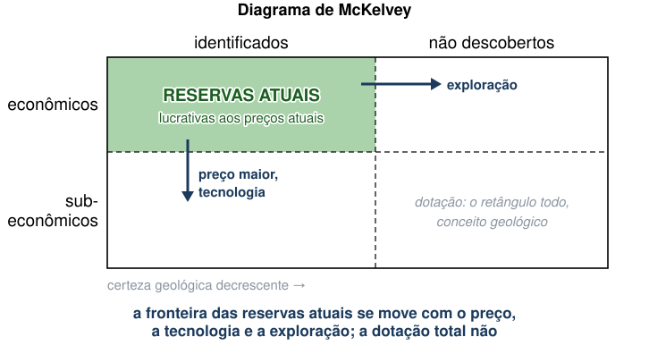{style="height:370px;max-height:370px"}
:::

- Reservas atuais: identificadas **e** lucrativas aos preços atuais.
- Preço maior ou tecnologia nova deslocam a fronteira para baixo; a
  exploração, para a direita [@keohane2016].

## Expandindo Reservas

::: {.no-bullet}
Conforme preço do recurso aumenta, pode valer a pena explorar novas
formas de extraí-lo.
:::

:::: {.columns}
::: {.column width="42%"}
::: {.no-bullet}
**Exemplo:**
:::

- Preço do petróleo aumentou substancialmente a partir de 2003.
- Alto preço induziu a criação de novas tecnologias de extração.
  - *Fracking* nos EUA.
- Queda no preço em 2015 trouxe dificuldades para *fracking*.
:::

::: {.column width="58%"}
::: {.diagram}
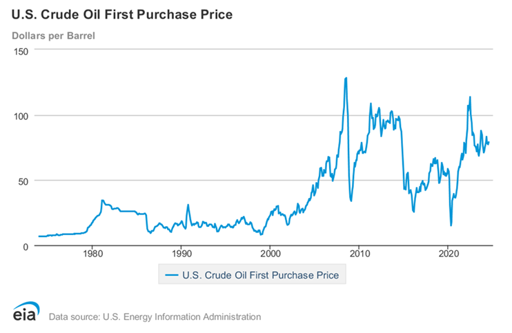{style="height:340px;max-height:340px"}
:::
:::
::::

## Quantos anos de petróleo restam?

::: {.diagram}
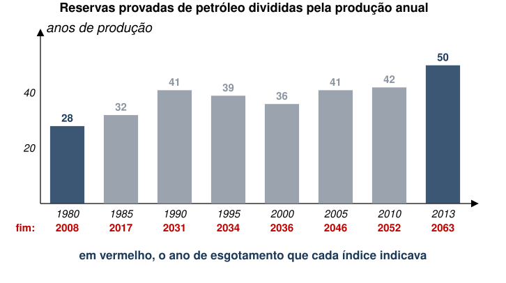{style="height:360px;max-height:360px"}
:::

- Em 1980, as reservas provadas cobriam 28 anos de produção: o petróleo
  acabaria em 2008. Em 2013, cobriam 50 anos [@keohane2016].
- O índice trata as reservas como um número fixo. Pela taxonomia, elas
  são **função do preço**.

## Tecnologia: o minério de ferro de Mesabi

::: {.no-bullet}
Em 1947, o presidente da Republic Steel estimou entre 5 e 7 anos a vida
útil das minas de Mesabi (Minnesota), fonte de cerca de 60% do minério
de ferro consumido pelos EUA na Segunda Guerra. Em 1955, a escassez já
não preocupava [@kakela1981].
:::

::: {.tabela}
|  | Antes | Com pelotização |
|---|---|---|
| Teor de ferro do minério usado | 50% a 65% | menos de 30% (taconita) |
| Energia por tonelada | | −17% |
| Trabalho por tonelada | | −8,2% |
| Produção de um alto-forno (t/dia) | 1.500 | 2.700 a 2.800 |
:::

- Minério de pior qualidade e custo **menor**: o progresso técnico pode
  conter o custo marginal total por um longo período [@tietenberg2018].

## Recursos Recicláveis

::: {.no-bullet}
Além de novas formas de extração, alguns recursos não-renováveis podem
ser reciclados ou reutilizados.
:::

::: {.no-bullet}
Novamente, o uso dessa "tecnologia" estará sujeito à sua lucratividade.
:::

- Reciclagem será usada na medida em que seja economicamente viável.

::: {.no-bullet}
**Exemplo:** vidro e alumínio são totalmente recicláveis.
:::

- Taxa de reciclagem do alumínio é de praticamente 100% no Brasil.
- Mas taxa de reciclagem do vidro é de apenas 26%.
  - Logística reversa é mais complexa, em parte porque recicladoras estão
    espacialmente concentradas.

::: {.fonte}
Fonte: <https://cempre.org.br/taxas-de-reciclagem/>
:::

## Reciclar dá prejuízo?

::: {.no-bullet}
Uma cidade gasta 20 por tonelada para coletar e separar material
reciclável e vende a sucata por 10. Deve reciclar?
:::

::: {.tabela}
|  | Conta do caixa | Conta econômica |
|---|---|---|
| Custo de reciclar | −20 | −20 |
| Venda da sucata | +10 | +10 |
| Aterro evitado | | +20 |
| **Saldo por tonelada** | **−10** | **+10** |
:::

- Cada tonelada reciclada deixa de ir para o aterro. O custo de descarte
  evitado é um **benefício** da reciclagem.
- [Pela conta do caixa, o programa "dá prejuízo". Pela conta econômica, é
  eficiente [@tietenberg2018].]{.fragment fragment-index=1}

## Quem decide não paga o descarte

::: {.diagram}
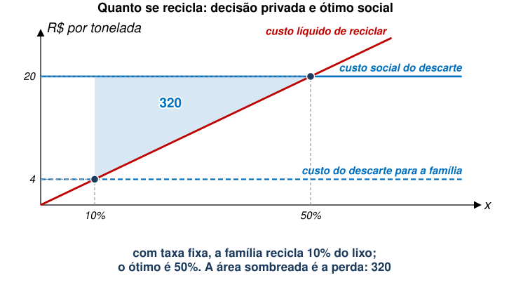{style="height:340px;max-height:340px"}
:::

- Quem separa o lixo é a família. Com taxa de coleta fixa, um saco a mais
  não custa nada a mais: ela só considera o próprio incômodo (4) e
  recicla 10% do lixo.
- [O ótimo considera o custo social do aterro (20): 50%. É a
  externalidade das aulas 03 a 07, agora no lixo.]{.fragment
  fragment-index=1}

## Cobrar pelo saco: o caso de Marietta

::: {.no-bullet}
Em 1994, Marietta (Geórgia, EUA) reduziu a taxa fixa de coleta de US\$ 15
para US\$ 8 por mês e testou duas cobranças adicionais
[@vanhoutven1999]:
:::

::: {.tabela}
| Programa | Como se paga | Um saco a mais custa | Lixo não reciclado |
|---|---|---|---|
| Saco | US\$ 0,75 por saco | US\$ 0,75 | até −51% |
| Lata | US\$ 3 a 4 por lata, contratado antes | nada, até o limite contratado | cerca de −20% |
:::

- [O saco funciona melhor porque cobra **na margem**: cada saco a mais
  custa. O contrato de latas é pago antes; o saco extra dentro do limite
  continua de graça.]{.fragment fragment-index=1}
- [Benefício líquido estimado para a cidade: US\$ 586 por dia com o saco,
  US\$ 234 com a lata [@tietenberg2018].]{.fragment fragment-index=2}

## Alocação Intertemporal Eficiente

::: {.no-bullet}
Voltemos ao modelo intertemporal, mas consideremos agora múltiplos
períodos.
:::

::: {.eq-block}
$$\max_{\{{q}_{1},...,{q}_{T}\}} \sum_{t=1}^{T} \frac{1}{{\left(1+r\right)}^{t-1}}\left[a{q}_{t}-\frac{b}{2}{q}_{t}^{2}-c{q}_{t}\right]+\lambda \left[\overline{Q}-\sum_{t=1}^{T} {q}_{t}\right]$$
:::

::: {.no-bullet}
As CPOs para um período $t$ qualquer são
:::

::: {.eq-block}
$$\frac{a-b{q}_{t}-c}{{\left(1+r\right)}^{t-1}}=\lambda , \qquad t\in \left\{1,2,...,T\right\}$$
:::

::: {.eq-block}
$$\overline{Q}=\sum_{t=1}^{T} {q}_{t}$$
:::

## Alocação Intertemporal Eficiente

::: {.no-bullet}
Vamos supor os mesmos parâmetros de antes
:::

- $a=8;b=0{,}4; c=2; r=0{,}1$
- Vamos mudar apenas $\overline{Q}=40$

::: {.no-bullet}
Relembremos que o Custo Marginal da Escassez aumenta com o tempo.
:::

- Recurso vai ficando mais escasso e mais caro.

::: {.no-bullet}
Com múltiplos períodos, em quanto tempo recurso é exaurido?
:::

## Alocação Intertemporal Eficiente

::: {.no-bullet}
É possível resolver recursivamente o problema de alocação eficiente
(chutando o valor de $\lambda$ inicial).
:::

- Com isso, desenhamos uma linha do tempo para a extração do recurso e
  seu custo marginal total.

::: {.diagram}
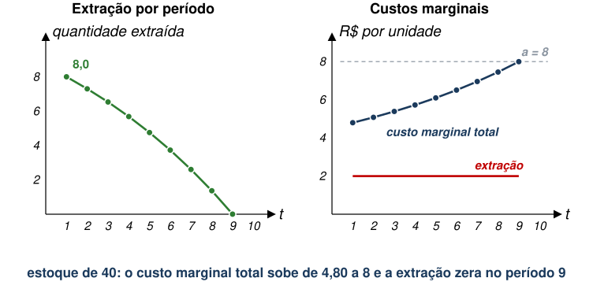{style="height:340px;max-height:340px"}
:::

## Alocação Intertemporal Eficiente

::: {.no-bullet}
Não há mais exploração do recurso a partir do período 9. Por quê?
:::

- [Custo marginal total igual à máxima disposição marginal a pagar
  ($a=8$).]{.fragment fragment-index=1}

::: {.diagram}
{style="height:340px;max-height:340px"}
:::

## Alocação Intertemporal Eficiente

::: {.no-bullet}
Como é de se esperar, se não há alternativa ao recurso.
:::

- A quantidade extraída diminui ao longo do tempo.
- O custo marginal total aumenta conforme é exaurido.
- Eventualmente, a extração vai deixar de ser economicamente viável.

::: {.no-bullet}
[A chegada à extração zero é suave: o preço sinaliza a escassez antes, e
o recurso não acaba "de repente" [@tietenberg2018].]{.fragment
fragment-index=1}
:::

## Recursos Renováveis

::: {.no-bullet}
Recursos renováveis têm alta taxa de reposição e podem, supostamente,
ser repostos perpetuamente.
:::

::: {.no-bullet}
Em muitos casos, essa taxa de reposição pode ser influenciada por
humanos.
:::

- Estoque de peixes;
- Nutrientes no solo;
- Árvores na floresta.

::: {.no-bullet}
Recursos renováveis podem servir como substitutos para recursos
não-renováveis.
:::

## Transição para Recurso Renovável

::: {.no-bullet}
Como o problema muda se existe um recurso renovável alternativo?
:::

::: {.no-bullet}
Vamos supor que esse recurso renovável seja um **substituto perfeito**
do recurso não-renovável.
:::

- Denote esse recurso como ${q}_{st}$ e seu custo marginal de extração
  como $d$.
- Neste caso, qual é o problema de maximização de bem-estar?

::: {.eq-block}
$$\begin{aligned}\max_{\substack{\{{q}_{1},...,{q}_{T}\}\\ \{{q}_{s1},...,{q}_{sT}\}}}\; &\sum_{t=1}^{T} \frac{1}{{\left(1+r\right)}^{t-1}}\left[a\left({q}_{t}+{q}_{st}\right)-\frac{b}{2}{\left({q}_{t}+{q}_{st}\right)}^{2}-c{q}_{t}-d{q}_{st}\right]\\ &+\lambda \left[\overline{Q}-\sum_{t=1}^{T} {q}_{t}\right]\end{aligned}$$
:::

## Transição para Recurso Renovável

- Como são substitutos perfeitos, solução depende dos valores de $d$ e
  $c$.
- Suponha $d=6>2=c$.
  - Enquanto custo marginal total $c+\lambda {\left(1+r\right)}^{t-1}<d$,
    teremos ${q}_{t}^{*}>0$ e ${q}_{st}^{*}=0$.
  - Quando $c+\lambda {\left(1+r\right)}^{t-1}>d$, teremos
    ${q}_{t}^{*}=0$ e ${q}_{st}^{*}>0$.

::: {.diagram}
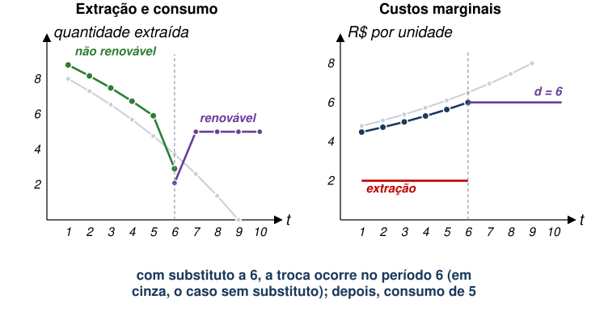{style="height:320px;max-height:320px"}
:::

## O que muda com o substituto

- A troca ocorre no período 6, não no 9. Com substituto, guardar
  recurso para o futuro vale menos: $\lambda$ cai de 2,80 para 2,48.
- Extrai-se **mais** no início.
- Depois da troca, o preço fica em $d=6$ e o consumo em
  $(8-6)/0{,}4=5$.
- O recurso renovável induz um **teto** para o preço do não renovável:
  ninguém paga pelo petróleo mais que pela energia equivalente do sol ou
  do vento [@keohane2016].

## Custo de Extração Crescente

::: {.no-bullet}
Além da existência de recursos alternativos, o custo de extração de um
recurso não-renovável tende a ser crescente.
:::

- Em mineração, primeiro extraem-se os minérios com concentração mais
  alta da substância de interesse (cobre ou estanho, por exemplo).

::: {.no-bullet}
Neste caso, podemos ter uma função de custo marginal dada por
:::

::: {.eq-block}
$$CM{g}_{t}=c+\alpha {Q}_{t}$$
:::

- Em que ${Q}_{t}=\sum_{k=1}^{t}{q}_{k}$, ou seja, a soma de tudo que já
  foi extraído até $t$.

## Custo de Extração Crescente

::: {.no-bullet}
Qualitativamente, se há recurso renovável alternativo, a conclusão é a
mesma.
:::

::: {.no-bullet}
Extrai-se o recurso não-renovável enquanto seu custo marginal total é
menor do que custo marginal do recurso renovável.
:::

::: {.diagram}
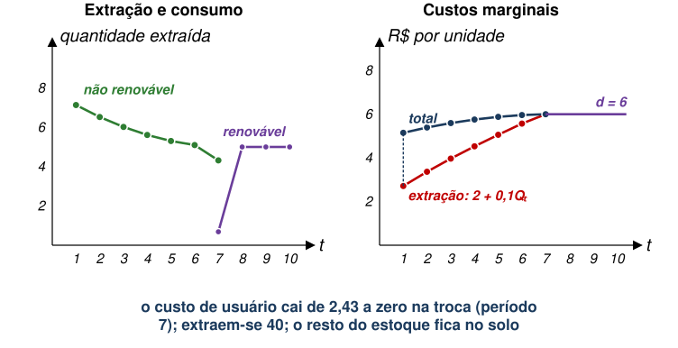{style="height:340px;max-height:340px"}
:::

## O que muda com o custo crescente

- Com $c=2$, $\alpha=0{,}1$ e $d=6$, o custo de usuário **cai** ao longo
  do tempo: de 2,43 a zero na troca. No custo constante, ele subia.
- Cada unidade extraída hoje encarece a extração futura. Perto da troca,
  guardar uma unidade quase nada vale para o futuro.
- O limite passa a ser econômico: a extração para em $Q=40$, onde
  $2+0{,}1Q=6$, para qualquer estoque acima disso. Com $\overline{Q}=60$,
  20 unidades ficam no solo porque custam mais que o substituto
  [@tietenberg2018].

## Custo ambiental da extração

::: {.diagram}
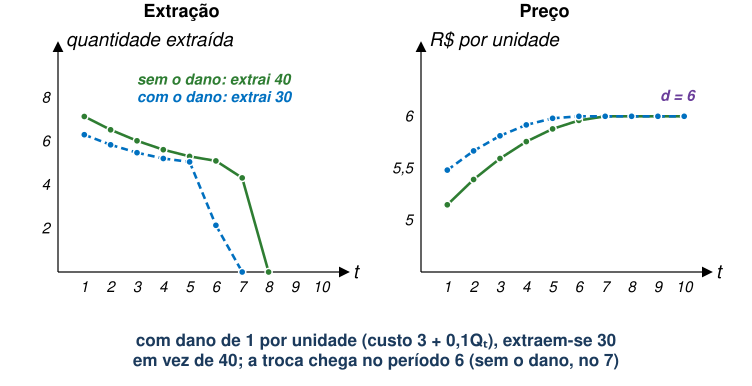{style="height:340px;max-height:340px"}
:::

- Suponha que cada unidade extraída cause um dano de 1, não pago pela
  mineradora. O custo social de extração passa a $3+0{,}1{Q}_{t}$.
- [Sem internalizar o dano: preço baixo demais, extração por período alta
  demais (7,13 contra 6,30 em $t=1$) e total extraído alto demais (40
  contra 30).]{.fragment fragment-index=1}

## Extrai-se mais, por mais tempo

::: {.diagram}
{style="height:340px;max-height:340px"}
:::

- Sem internalizar o dano, a troca para o renovável chega **mais tarde**
  (período 7 contra 6). Por quê?
- [O preço maior reduz o consumo e alongaria o uso, mas há menos a
  extrair. No exemplo, prevalece o segundo efeito
  [@tietenberg2018].]{.fragment fragment-index=1}

## O paradoxo verde

- Sinn (2008): um imposto sobre carbono que **cresce mais rápido que
  $r$** reduz o ganho de esperar e antecipa a extração [@sinn2008].
- A antecipação ocorre tanto com custo de extração constante como crescente. O
  que muda entre os dois casos é o total extraído:
  - Custo constante: estoque de recurso esgota antes com imposto, mas o total extraído é igual ao cenário sem imposto.
  - Custo crescente: além de antecipar, o imposto encarece as últimas unidades e faz com que mais recursos fiquem guardados no solo.

::: {.no-bullet}
Considere este exemplo, com custo constante. Por que a taxa de crescimento do   imposto importa?
:::

## Paradoxo verde em números

::: {.no-bullet}
Mesmo modelo de N períodos: $\overline{Q}=40$, $c=2$, sem substituto.
Cada unidade extraída emite uma unidade de CO$_2$.
:::

- Os donos do recurso pagam um imposto por unidade
  ${\tau}_{t}=0{,}5{\left(1+g\right)}^{t-1}$. A CPO passa a ser

::: {.eq-block}
$$\frac{a-b{q}_{t}-c-{\tau}_{t}}{{\left(1+r\right)}^{t-1}}=\lambda$$
:::

- [Com $g=r$, o termo ${\tau}_{t}/{\left(1+r\right)}^{t-1}$ vale 0,5 em
  todo período. O imposto reduz $\lambda$ (de 2,80 para 2,30), mas a extração se comporta exatamente como no caso sem imposto: a decisão intertemporal não muda.]{.fragment fragment-index=1}
- [Com $g>r$, esse termo cresce com $t$. Extrai-se antes, porque adiar custa mais caro.]{.fragment fragment-index=2}

## Um imposto que cresce 30%

::: {.diagram}
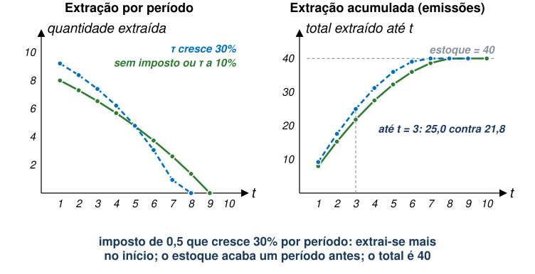{style="height:340px;max-height:340px"}
:::

- Com $g=0{,}3$, a extração no período 1 sobe de 8,0 para 9,22. O estoque
  acaba no período 7 (sem imposto, no 8).
- [O total emitido continua 40. O que muda é a data: até $t=3$, saem 25,0
  em vez de 21,8.]{.fragment fragment-index=1}

## Quatro trajetórias do imposto

::: {.tabela}
| Imposto $\tau_t$ | $q_1$ | Último período | Extraído até $t=3$ | VP do dano |
|---|---|---|---|---|
| Sem imposto | 8,00 | 8 | 21,84 | 32,06 |
| Constante, 0,5 | 7,58 | 9 | 20,84 | 31,60 |
| Cresce 10% ($=r$) | 8,00 | 8 | 21,84 | 32,06 |
| Cresce 30% | 9,22 | 7 | 25,00 | 33,32 |
:::

- Dano de 1 por unidade, a VP com $r=0{,}1$. O total extraído é 40 em
  todas as linhas.
- [Com custo crescente ($2+0{,}1{Q}_{t}$, $d=6$), o imposto de 30% ainda
  antecipa ($q_1$ de 7,13 para 7,84). O total extraído, porém, cai de 40
  para 26,8; o VP do dano cai de 31,5 para 23,7.]{.fragment
  fragment-index=1}
- [A avaliação inicial da literatura é que o paradoxo não é obstáculo
  sério à política climática, mas a evidência empírica ainda é escassa
  [@tietenberg2018].]{.fragment fragment-index=2}

## Recurso Parcialmente Renovável

::: {.no-bullet}
**Exercício**
:::

- Considere o modelo de 2 períodos com $Cmg(q)=c$
- A demanda ainda é dada por ${P}_{t}\left(q\right)=a-b{q}_{t}$
- Suponha, no entanto, que o recurso $q$ seja parcialmente renovável
  - O estoque remanescente de $q$ no período 1 cresce a uma taxa
    $(1+s)$

::: {.no-bullet}
Qual é a alocação eficiente neste caso?
:::

## Exercício em duplas

::: {.no-bullet}
$a=8$, $b=0{,}4$, $c=2$, $r=0{,}1$. O estoque inicial é 21. O que fica
no solo depois do período 1 cresce $s=0{,}1$.
:::

- **(a)** Escreva a restrição que liga ${q}_{1}$ e ${q}_{2}$.
- **(b)** Mostre que, no ótimo,
  $a-b{q}_{1}-c=\dfrac{1+s}{1+r}\left(a-b{q}_{2}-c\right)$.
- **(c)** Calcule ${q}_{1}^{*}$ e ${q}_{2}^{*}$.
- **(d)** Compare $V({q}_{1}^{*})$ e $V({q}_{2}^{*})$. A alocação é
  sustentável?
- **(e)** O que muda se $s>r$?

## Solução

- **(a)** ${q}_{2}\leq (1+s)(21-{q}_{1})$.
- [**(b)** Com multiplicador $\mu$: $a-b{q}_{1}-c=\mu (1+s)$ e
  $\frac{a-b{q}_{2}-c}{1+r}=\mu$. Dividindo uma pela
  outra.]{.fragment fragment-index=1}
- [**(c)** Com $s=r$, os benefícios marginais se igualam:
  ${q}_{1}={q}_{2}=q$ e $q=1{,}1(21-q)$, logo
  ${q}^{*}=11$.]{.fragment fragment-index=2}
- [**(d)** $V(11)=41{,}8$ nas duas gerações: a alocação é eficiente
  **e** sustentável.]{.fragment fragment-index=3}
- [**(e)** Com $s>r$, o recurso no solo rende mais que o banco:
  ${q}_{2}^{*}>{q}_{1}^{*}$.]{.fragment fragment-index=4}

## Solução em um gráfico

::: {.diagram}
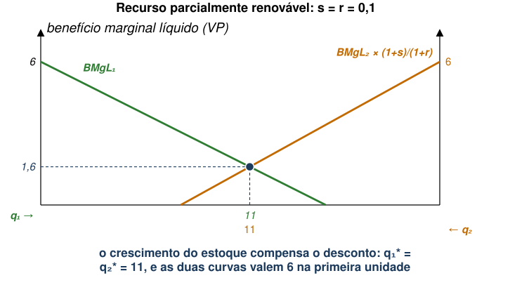{style="height:370px;max-height:370px"}
:::

- No cruzamento, os dois benefícios marginais líquidos valem 1,6. O
  crescimento do estoque compensa exatamente o desconto.

## O que o exercício mostra

::: {.tabela}
| Alocação | ${q}_{1}$ | ${q}_{2}$ | ${V}_{1}$ | ${V}_{2}$ |
|---|---|---|---|---|
| Sem escassez ($\overline{Q}\geq 30$) | 15 | 15 | 45 | 45 |
| Míope ($\overline{Q}=20$, 15 hoje) | 15 | 5 | 45 | 25 |
| Eficiente ($\overline{Q}=20$, $r=0{,}1$) | 10,24 | 9,76 | 40,46 | 39,51 |
| Igualitária ($\overline{Q}=20$) | 10 | 10 | 40 | 40 |
| Parcialmente renovável (21, $s=r$) | 11 | 11 | 41,8 | 41,8 |
:::

- Com recurso esgotável e $r>0$, a alocação eficiente favorece a geração
  presente.
- A diferença desaparece quando o estoque rende o mesmo que o banco
  ($s=r$). Fora disso, a transferência concilia eficiência e
  sustentabilidade.

## Voltando à pergunta da abertura

::: {.no-bullet}
**Vinte barris para duas gerações, juros de 10%. Como a alocação
eficiente divide o estoque?**
:::

::: {.opcoes}
- A resposta é **(b)**: 10,24 para a geração presente. O barril de
  amanhã vale menos hoje.

- **(a)** só valeria com $r=0$, ou se o estoque crescesse à taxa de
  juros, como no exercício.

- **(c)** exigiria $s>r$, ou uma demanda futura maior.

- **E é justa?** Não automaticamente: a geração presente precisa aplicar
  a sobra de 0,46 em favor da futura.
:::

## Concluindo

- Recursos naturais acrescentam o **tempo** ao problema: extrair hoje tem
  um custo de oportunidade, o custo marginal da escassez $\lambda$.
- Com custo de extração constante, $\lambda$ cresce à taxa de juros
  (regra de Hotelling). Com custo crescente, cai a zero na transição.
- Com direitos de propriedade bem definidos, o mercado incorpora
  $\lambda$; com acesso aberto, não.
- Eficiência dinâmica não garante sustentabilidade. Investir a renda de
  escassez (regra de Hartwick) garante a versão fraca.
- Reservas são função de preço e tecnologia; índices físicos de
  esgotamento enganam.
- Custos ambientais não internalizados levam a extrair rápido demais e
  em excesso.

## Próxima aula

::: {.no-bullet}
**Clima e Energia.**
:::

::: {.no-bullet}
O renovável é um teto para o preço do fóssil. A transição eficiente é
suave. Por que, então, a transição energética precisa de política
pública?
:::

## Referências

::: {#refs}
:::
