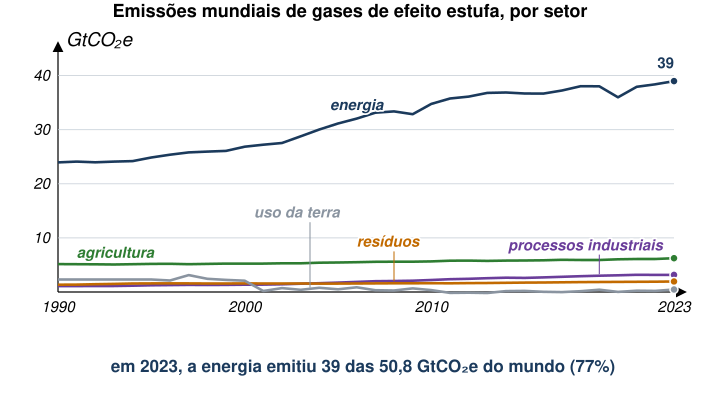
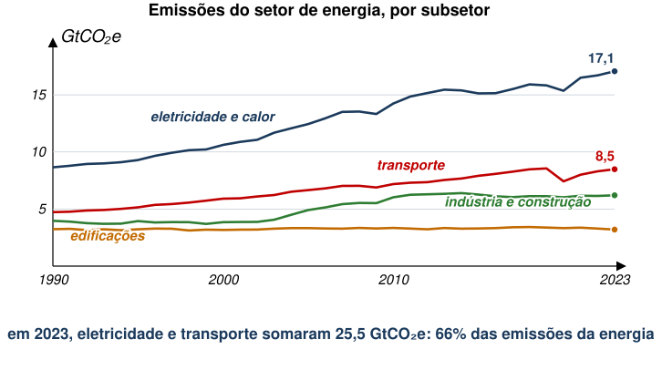
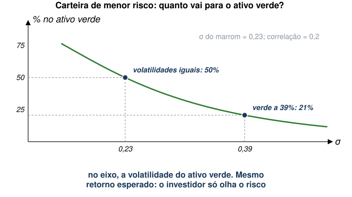
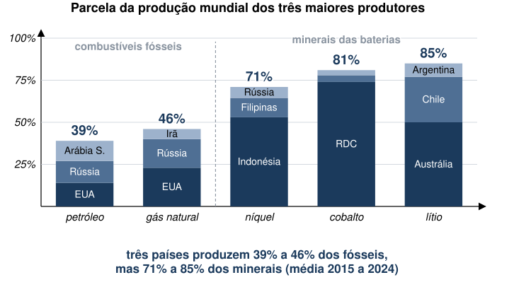
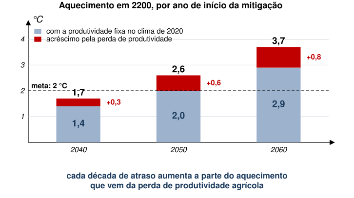

## Aula Passada

- Taxonomia dos Recursos Não-Renováveis
- Reciclagem
- Alocação Intertemporal
  - Sem Substitutos
  - Com Substitutos
  - Custo Marginal Crescente
  - Recurso Parcialmente Renovável

::: {.no-bullet}
Referência: Tietenberg e Lewis, cap. 6
:::

## Agenda

- Transição Energética
- Alguns Desafios
  - Volatilidade de preços
- Como induzir transição energética?
  - Caso dos veículos elétricos
- Minerais Críticos
  - Poder de mercado e geopolítica
- Energia de Biomassa
  - Potencial e riscos

## Transição Energética {.section-cover}

## Transição Energética

::: {.no-bullet}
**Por que importa?**
:::

- Maior parte das emissões vem do setor de energia (\~75%)

::: {.diagram}
{style="height:340px;max-height:340px"}
:::

::: {.fonte}
Fonte: Climate Watch Historical Country Greenhouse Gas Emissions Data
(CC BY 4.0). Figura reelaborada a partir dos dados.
:::

## Transição Energética

::: {.no-bullet}
**Por que importa?**
:::

- Geração de eletricidade e transporte são as maiores subcategorias.

::: {.diagram}
{style="height:340px;max-height:340px"}
:::

::: {.fonte}
Fonte: Climate Watch Historical Country Greenhouse Gas Emissions Data
(CC BY 4.0). Figura reelaborada a partir dos dados.
:::

## Transição Energética

::: {.no-bullet}
**Por que importa?**
:::

::: {.no-bullet .solto}
Há, também, outras dimensões importantes além da crise climática.
:::

- **Segurança energética:** conflito entre Ucrânia e Rússia; guerra no
  Irã.
- **Sustentabilidade:** recursos não-renováveis são finitos.
- **Ganho de eficiência:** energia renovável pode ser mais barata no
  longo prazo.

## Transição Energética

::: {.no-bullet}
**Vale a pena?**
:::

- Ganhos com redução de danos compensam custos mais altos de energia.
- Mas altos investimentos serão necessários.

::: {.content-visible when-profile="restrito"}
::: {.diagram}
{style="height:370px;max-height:370px"}
:::
:::

::: {.content-hidden when-profile="restrito"}
::: {.tabela}
| Cenário de emissão líquida zero em 2050 | 2030 | 2040 | 2050 |
|---|---|---|---|
| Danos evitados (agudos e crônicos) | 1,6 | 4,8 | 9,3 |
| Custos da política de mitigação | −0,8 | −0,7 | −1,6 |
| **Benefício líquido** | **0,7** | **4,1** | **7,7** |
:::

::: {.fonte}
PIB mundial, desvio em relação ao cenário de referência (%). Valores
aproximados, lidos do gráfico do FMI a partir de NGFS (2023).
:::
:::

## Transição Energética

::: {.no-bullet}
**Quanto custa?**
:::

- Para alcançar um cenário de zero emissões líquidas (*net zero*):
  US\$ 3,5 trilhões por ano entre 2021 e 2050.
- Em 2024, investimentos alcançaram US\$ 2,1 trilhões (ainda aquém).

::: {.content-visible when-profile="restrito"}
::: {.diagram}
{style="height:285px;max-height:285px"}
:::
:::

::: {.content-hidden when-profile="restrito"}
::: {.tabela}
| Energia elétrica | Edificações | Transporte |
|---|---|---|
| Geração sem carbono: 1.300 | Reformas: 230 | Recarga nas estradas: 130 |
| Redes: 900 | Bombas de calor: 130 | Aviação: 70 |
| Armazenamento e flexibilidade: 200 | Aquecimento renovável: 140 | Navegação: 40 |
:::
:::

::: {.fonte}
Investimento médio necessário por ano, 2021 a 2050, em US\$ bilhões.
Fonte: National Public Utilities Council.
:::

## Transição Energética

::: {.no-bullet}
**Quanto custa?**
:::

- Aumento da dívida pública → 15% no longo prazo.

::: {.content-visible when-profile="restrito"}
::: {.diagram}
{style="height:385px;max-height:385px"}
:::
:::

::: {.content-hidden when-profile="restrito"}
::: {.tabela}
| Aumenta a dívida | p.p. do PIB | Reduz a dívida | p.p. do PIB |
|---|---|---|---|
| Investimento verde | +22 | Receita de carbono | −26 |
| Juros reais | +9 | Crescimento do PIB | −5 |
| Transferências focalizadas | +7 | | |
| Perda de outras receitas | +7 | | |
| Subsídios verdes | +2 | **Dívida/PIB, total** | **+16** |
:::

::: {.fonte}
Economia emergente representativa, variação acumulada da dívida entre
2023 e 2050. Valores aproximados, lidos do gráfico do FMI (*Fiscal
Monitor*, out. 2023).
:::
:::

## Alguns Desafios {.section-cover}

## Alguns Desafios

::: {.no-bullet}
Uma questão recorrente sobre energias renováveis é seu custo.
:::

- Muitas vezes, é mais caro gerar energia com fontes renováveis.

::: {.no-bullet .solto}
Além disso, há riscos envolvidos.
:::

- Fontes renováveis, como solar e eólica, dependem de condições
  climáticas incertas.
- Dias de pouco vento ou sol podem causar queda de oferta e aumento de
  preço.

## Alguns Desafios

::: {.no-bullet}
Hong et al. (2025) estudam a volatilidade de preço para energia
renovável, tentando entender sua importância para a transição
energética.
:::

::: {.no-bullet .solto}
Como?
:::

- Usando dados de geradoras e distribuidoras, investigam a introdução de
  exigências em relação ao seus portfólios de renováveis e
  não-renováveis.
- Aproveitam o fato de que, em muitos estados dos EUA, empresas de
  capital aberto precisaram aumentar uso de renováveis, enquanto
  empresas municipais, não.
- Comparam esses dois grupos de empresas antes e depois da política.

## Alguns Desafios

::: {.no-bullet}
Diferenças-em-Diferenças → firmas que precisaram aumentar *share* de
renováveis (tratadas) e isentas (controles).
:::

- Preço e volatilidade aumentam após exigência de renováveis.

::: {.content-visible when-profile="restrito"}
::: {.diagram}
{style="height:360px;max-height:360px"}
:::
:::

::: {.content-hidden when-profile="restrito"}
::: {.tabela}
| Efeito da exigência de renováveis | Estimativa |
|---|---|
| Volatilidade mensal do preço da eletricidade | +4,3 p.p. ao ano |
| Lucro médio das firmas | não muda (o regulador repassa o custo) |
| Estados com exigência de renováveis (1991 a 2020) | 32, dos quais 14 isentam as municipais |
:::

::: {.fonte}
Números do texto de @hong2025.
:::
:::

## Alguns Desafios

::: {.no-bullet}
Autores verificam que aumento da volatilidade levou a uma **maior
percepção de risco**, por parte de investidores, para as **empresas com
exigência de renováveis**.
:::

- ↑ *Corporate Bond Yields*

::: {.content-visible when-profile="restrito"}
::: {.diagram}
{style="height:390px;max-height:390px"}
:::
:::

::: {.content-hidden when-profile="restrito"}
::: {.tabela}
| Medida de risco | Renováveis | Fósseis |
|---|---|---|
| Aumento do *spread* de crédito das tratadas | +69 a 100 pontos-base | |
| Volatilidade imputada dos ativos | 39% | 23% |
:::

::: {.fonte}
O risco a mais não é repassado ao consumidor: fica com firmas e
investidores [@hong2025].
:::
:::

## Alguns Desafios

::: {.no-bullet}
Em seguida, autores simulam diferentes cenários de produtividade e
volatilidade, comparando energias renováveis e não-renováveis.
:::

::: {.no-bullet .solto}
A alocação ótima de investimento em energia "verde" vai de 19% no
cenário base para
:::

- 48%, se a volatilidade for igual entre renováveis e não-renováveis;
- 22%, se produtividade for igual entre renováveis e não-renováveis;
- 25%, se produtividade for duas vezes maior para renováveis.

::: {.no-bullet .solto}
Ou seja, risco tem papel importante na alocação ótima de energia
renovável.
:::

## Por que a volatilidade pesa tanto?

::: {.diagram}
{style="height:350px;max-height:350px"}
:::

- Intuição de carteira: dois ativos com o mesmo retorno esperado. Com
  volatilidades iguais, metade vai para cada um.
- [Com a volatilidade imputada por Hong et al. (39% contra 23%), a
  carteira de menor risco põe 21% no verde. É a ordem de grandeza dos
  19% do cenário base.]{.fragment fragment-index=1}

## Alguns Desafios

::: {.no-bullet}
Conclusão dos autores é de que o risco associado às fontes renováveis
pode ser tão relevante quanto sua produtividade para descarbonização.
:::

- Ou seja, não bastaria gerar tanta eletricidade quanto não-renováveis.
- Seria necessário diminuir o risco para investimentos em renováveis.

::: {.fonte}
Referência: Hong, Harrison, Jeffrey D. Kubik, and Edward P. Shore. 2025.
Renewable Asset Price Volatility and Its Implications for
Decarbonization. NBER Working Paper No. 33789.
<https://doi.org/10.3386/w33789>.
:::

## Como induzir transição energética? {.section-cover}

## Como induzir transição energética?

::: {.no-bullet}
Além de enfrentar desafios relacionados ao custo e à incerteza de
fontes renováveis, é preciso pensar na melhor forma de induzir sua
adoção.
:::

- Impostos sobre não renováveis ou subsídio às renováveis?

::: {.no-bullet .solto}
Bushnell et al. (2022) investigam essa questão na adoção de veículos
elétricos.
:::

- O que importa mais para o comprador de um veículo: preço da gasolina
  ou da energia elétrica?

## Como induzir transição energética?

::: {.no-bullet}
Variável de interesse: venda de veículos elétricos por habitante, por
setor censitário da Califórnia, de 2014 a 2017.
:::

::: {.no-bullet .solto}
**Estratégia de Identificação 1: painel**
:::

- Regressão com dados em painel, usando variação (exógena) nos preços de
  gasolina e energia elétrica.
- Efeitos fixos de setor censitário e de período: cada local é comparado
  com ele mesmo ao longo do tempo.
- A variação vem dos reajustes das tarifas reguladas de eletricidade e
  das oscilações do preço da gasolina.

## Como induzir transição energética? {style="font-size:0.9em"}

::: {.no-bullet}
**Estratégia de Identificação 2: descontinuidade na fronteira entre
distribuidoras**
:::

- Na Califórnia, distribuidoras municipais cobram uma fração da tarifa
  das de capital aberto.
- Setores censitários vizinhos se defrontam com decisões de transporte e
  infraestrutura de carregamento parecidas
  - Mas pagam tarifas muito diferentes.

::: {.content-visible when-profile="restrito"}
::: {.diagram}
{style="height:340px;max-height:340px"}
:::
:::

::: {.content-hidden when-profile="restrito"}
::: {.tabela}
| Distribuidora (Baía de São Francisco) | Controle | US\$ por kWh, 2018 |
|---|---|---|
| PG&E | capital aberto | 0,40 |
| San Francisco (CCSF) | municipal | 0,33 |
| Alameda | municipal | 0,26 |
| Palo Alto | municipal | 0,19 |
| Santa Clara | municipal | 0,12 |
:::

::: {.fonte}
Tarifa residencial, faixa mais alta de consumo. Valores aproximados,
lidos da fig. 1 de @bushnell2022.
:::
:::

## Como induzir transição energética?

::: {.no-bullet}
Em ambas as estimações, aumento no preço da gasolina tem efeito de 4 a
6 vezes maior na venda de veículos elétricos do que aumento equivalente
no preço da energia elétrica.
:::

- [Equivalente no custo por milha: um centavo a mais por milha na
  gasolina pesa de 4 a 6 vezes o que pesa um centavo a mais por milha na
  eletricidade.]{.fragment fragment-index=1}

::: {.no-bullet .solto .fragment fragment-index=2}
Ou seja, o comprador dá pouco peso à conta de luz que o carro vai gerar.
:::

::: {.no-bullet .solto .fragment fragment-index=3}
No entanto, se custo operacional do carro (preço do "combustível")
aumenta, deveria haver menor demanda.
:::

- [Por que o efeito do preço seria diferente entre gasolina e
  eletricidade?]{.fragment fragment-index=3}

## Como induzir transição energética?

::: {.no-bullet}
Autores argumentam que consumidores entendem melhor como o preço da
gasolina impacta seu orçamento.
:::

- Ao abastecer o carro, fica evidente quanto se gastou.
- No caso da eletricidade, é mais difícil calcular quanto do consumo de
  energia da casa é atribuível ao carro.

::: {.no-bullet .solto}
Para política pública, isto é relevante.
:::

- Aponta para qual intervenção pode ser mais eficiente se o objetivo for
  incentivar compra de veículos elétricos.

::: {.fonte}
Referência: Bushnell, James B., Erich Muehlegger, and David S. Rapson.
2022. Energy Prices and Electric Vehicle Adoption. NBER Working Paper No.
29842. <https://doi.org/10.3386/w29842>.
:::

## Imposto ou subsídio? {style="font-size:0.92em"}

::: {.no-bullet}
Em aulas passadas, imposto e subsídio agiam na mesma margem, com
sinais opostos.
:::

::: {.no-bullet .solto .fragment fragment-index=1}
Aqui a margem não é a mesma para o consumidor. O preço da gasolina é
visto na bomba; o custo da recarga se perde na conta de luz.
:::

- [Baratear a eletricidade para quem recarrega move pouco a compra do
  elétrico.]{.fragment fragment-index=1}
- [Encarecer a gasolina tem mais efeito.]{.fragment fragment-index=1}

::: {.no-bullet .solto .fragment fragment-index=2}
Com dados da Califórnia, os autores calculam quanto o governo deveria
pagar a quem compra um carro elétrico. A resposta é positiva: vale
subsidiar.
:::

- [Mas esse valor é o saldo de duas forças que puxam em direções
  opostas: uma favorece subsídio; a outra, imposto.]{.fragment
  fragment-index=2}

## Duas margens, sinais opostos

::: {.no-bullet}
O instrumento de preço ótimo soma duas correções:
:::

- **Externalidade:** na Califórnia, o imposto da gasolina já cobre o
  dano, mas a tarifa de luz fica acima do custo social marginal.

  → **Subsidiar** o elétrico.

- [**"Erro" do comprador:** muitos pagam tarifa maior do que a média,
  mas subestimam custo do elétrico na conta de energia, o que aumenta
  compra deste tipo de veículo.]{.fragment fragment-index=1}

  [→ **Taxar** o elétrico.]{.fragment fragment-index=1}

::: {.no-bullet .solto .fragment fragment-index=2}
Saldo do artigo: subsídio de cerca de US\$ 200 a 300 por ano.
:::

## Minerais Críticos {.section-cover}

## Do carro elétrico à mina {style="font-size:0.97em"}

::: {.no-bullet}
Carros elétricos precisam de baterias, que, por sua vez, precisam de
**lítio, níquel e cobalto**.
:::

- Baterias de veículos elétricos são 80% da capacidade instalada de
  baterias anual no mundo.
- Respondem por 65% da demanda mundial de lítio e por 45% da de cobalto.

::: {.no-bullet .solto .fragment fragment-index=1}
A cadeia tem três elos, todos concentrados: mineração (Austrália,
Indonésia, RDC), refino e baterias (empresas chinesas refinam de 65% a
80% e fabricam cerca de 70% das baterias), montadoras.
:::

::: {.no-bullet .solto .fragment fragment-index=2}
Domínguez-Iino, Elliott e Hsiao (2026) perguntam: se poucos países
controlam esses minerais, como seu poder de mercado afeta a transição?
:::

## Minerais mais concentrados que o petróleo

::: {.diagram}
{style="height:350px;max-height:350px"}
:::

- Petróleo: os três maiores produtores somam 39%.
- [Lítio: a Austrália sozinha produz metade.]{.fragment fragment-index=1}

## Um modelo com dois minerais

::: {.no-bullet}
Dois minerais, lítio ($\ell$) e níquel ($n$). Duas baterias: $L$ (LFP)
usa só lítio; $N$ (NMC) usa lítio **e** níquel, em proporção fixa.
:::

::: {.no-bullet .solto}
Com fabricação competitiva, o preço da bateria é o custo dos minerais:
:::

::: {.eq-block}
$$p_L = p^{\ell}\, r^{\ell}_{L}, \qquad p_N = p^{\ell}\, r^{\ell}_{N} + p^{n}\, r^{n}_{N}$$
:::

- [$r^{m}_{j}$ é a composição química: quilos do mineral $m$ por unidade
  da bateria $j$.]{.fragment fragment-index=1}

::: {.no-bullet .solto .fragment fragment-index=2}
As baterias são substitutas: $\delta_{LN}=\partial d_L/\partial p_N>0$.
:::

- [O efeito próprio domina: $\delta_{NN}=\partial d_N/\partial p_N<0$ e
  $\delta_{LN}+\delta_{NN}<0$ (a demanda total cai quando uma bateria
  encarece).]{.fragment fragment-index=2}

## O níquel encarece. E o lítio?

::: {.eq-block}
$$\frac{\partial d^{\ell}}{\partial p^{n}}=\underbrace{\delta_{LN}\, r^{\ell}_{L}\, r^{n}_{N}}_{(1)\;>\;0}+\underbrace{\delta_{NN}\, r^{\ell}_{N}\, r^{n}_{N}}_{(2)\;<\;0}$$
:::

::: {.no-bullet .fragment fragment-index=1}
**(1) Substituição:** a bateria $N$ fica mais cara, a demanda migra para
$L$, que usa lítio. A demanda por lítio sobe.
:::

::: {.no-bullet .fragment fragment-index=2}
**(2) Complementaridade:** a bateria $N$ vende menos. Como ela também usa
lítio, a demanda por lítio cai.
:::

::: {.no-bullet .solto .fragment fragment-index=3}
Se a soma é positiva, lítio e níquel são **substitutos brutos**. Se é
negativa, são **complementos brutos**.
:::

- [Qual força domina é uma questão empírica.]{.fragment fragment-index=3}

## Por que o sinal importa?

::: {.no-bullet}
Se a Indonésia restringe oferta de níquel para elevar o preço, temos:
:::

::: {.tabela}
| | Substitutos brutos | Complementos brutos |
|---|---|---|
| Preço do lítio | sobe | cai |
| Austrália (lítio) | ganha de carona | perde |
| Interesses dos dois países | alinhados | em conflito |
| Bateria $L$ (LFP) | encarece | **barateia** |
:::

::: {.no-bullet .solto .fragment fragment-index=1}
Com complementos, a política da Indonésia funciona como um imposto sobre
a bateria $N$ e um subsídio à bateria $L$. A adoção total cai, mas cai
menos.
:::

## Simulação: eliminar o maior produtor

::: {.tabela}
| Sai do mercado | Lítio | Níquel | Cobalto | Bateria L | Bateria N |
|---|---|---|---|---|---|
| Austrália (50% do lítio) | **+107** | −1,1 | −3,7 | +9,5 | +9,5 |
| Indonésia (53% do níquel) | −1,8 | **+76** | −3,4 | −0,2 | +3,6 |
| RDC (74% do cobalto) | −6,2 | −3,7 | **+865** | −0,6 | +14,1 |
:::

::: {.fonte}
Variação média de preço (%), @dominguez2026, tabela 2. Bateria L: LFP;
bateria N: NMC e NCA.
:::

::: {.no-bullet .solto}
O preço do mineral que falta dispara; o dos outros dois **cai**: é a
assinatura empírica da complementaridade.
:::

::: {.no-bullet .solto .fragment fragment-index=1}
Sem lítio australiano, as duas baterias encarecem (insumo comum). Sem
níquel ou cobalto, a LFP fica até mais barata.
:::

## A China: dona de minas em três minerais {style="font-size:0.94em"}

::: {.no-bullet}
Multinacionais chinesas têm participação em minas de lítio, níquel e
cobalto pelo mundo. Controlar vários minerais tem duas forças opostas.
:::

- [**Anticompetitiva:** as baterias $L$ e $N$ são substitutas; quem
  controla os dois minerais deixa de competir entre elas.]{.fragment
  fragment-index=1}
- [**Pró-competitiva:** na bateria $N$, lítio e níquel são complementos.
  Donos separados ignoram que o preço alto de um reduz a venda do outro;
  um dono só leva isso em conta e restringe menos (complementaridade de
  Cournot, 1838).]{.fragment fragment-index=2}

::: {.no-bullet .solto .fragment fragment-index=3}
Como os minerais são complementos brutos, a segunda força domina, ainda
que por pouco.
:::

::: {.no-bullet .solto .fragment fragment-index=4}
**Coordenação vertical:** a China é a maior compradora de baterias.
Mineral caro prejudica as próprias montadoras.
:::

## Multinacionais ou países?

::: {.content-visible when-profile="restrito"}
::: {.diagram}
{style="height:330px;max-height:330px"}
:::
:::

::: {.content-hidden when-profile="restrito"}
::: {.tabela}
| Quem exerce o poder de mercado | Preço das baterias | Quantidade |
|---|---|---|
| Austrália e Indonésia, cada uma por si | +2,7% | −2,6% |
| Minas chinesas de lítio e níquel, coordenadas | +0,6% | −0,6% |
:::

::: {.fonte}
Valores aproximados, lidos da fig. 15 de @dominguez2026.
:::
:::

- **Cenário "Top producers":** principais produtores de cada mineral
  impõem impostos sobre a produção para maximizar excedente do produtor e
  receita do imposto.
- [**Cenário "China":** escolha de impostos que maximizam excedente e
  receita das empresas com controle chinês, levando em consideração a
  complementaridade entre minerais.]{.fragment fragment-index=1}

::: {.no-bullet .fragment fragment-index=2}
Cartel chinês é menos prejudicial do que cartel de cada país
separadamente.
:::

## Multinacionais ou países?

::: {.no-bullet}
Possível interpretação:
:::

- Se maiores produtores de minerais nacionalizarem recursos (a exemplo
  da OPEP), **preços serão maiores e transição energética pode ser
  atrasada**.
- [Mecanismo de coordenação horizontal (via multinacionais chinesas) pode
  facilitar transição.]{.fragment fragment-index=1}

::: {.fonte}
Referência: Domínguez-Iino, Tomás, Jonathan T. Elliott, and Allan Hsiao.
2026. Critical Minerals, Geopolitics, and the Green Transition. Working
paper. <https://tdomingueziino.github.io/critical_minerals.pdf>.
:::

## Energia de Biomassa {.section-cover}

## Energia de Biomassa

::: {.no-bullet}
Mais próximo de casa: transição energética baseada em fontes como
etanol ou bagaço de cana.
:::

- Ideia é que cana-de-açúcar absorve carbono ao crescer, compensando
  parcialmente emissões posteriores de veículos movidos a etanol.

::: {.no-bullet .solto}
Há grande expectativa sobre o potencial da biomassa como fonte de
energia de baixo carbono, especialmente no Brasil.
:::

- Entretanto, há desafios.

## Energia de Biomassa

::: {.no-bullet}
Com agravamento da crise climática, retorno das plantações diminui.
:::

- Cada hectare de cana-de-açúcar plantada produz menos matéria-prima
  para etanol.

::: {.no-bullet .solto}
Como essa queda de produtividade pode afetar o potencial de redução de
carbono da biomassa?
:::

- [Para produzir a mesma quantidade, agricultores precisam ocupar área
  maior.]{.fragment fragment-index=1}
- [No Brasil, muitas vezes isso significa mais desmatamento, fazendo
  aumentar as emissões.]{.fragment fragment-index=1}

## Quanto a área precisa crescer?

::: {.no-bullet}
Produção = produtividade × área. Para manter a produção, a área cresce
na razão inversa da produtividade: $A=Q/y$.
:::

::: {.tabela}
| Queda da produtividade | Área necessária |
|---|---|
| 10% | +11% |
| 20% | +25% |
| 30% | +43% |
:::

::: {.no-bullet .solto .fragment fragment-index=1}
A área cresce mais que a perda de produtividade; a diferença aumenta com
a perda: $1/(1-0{,}3)=1{,}43$.
:::

::: {.no-bullet .solto .fragment fragment-index=2}
Se a área nova vem de floresta, a emissão do desmatamento desconta o
carbono que o etanol evitaria.
:::

## Energia de Biomassa

::: {.no-bullet}
Mesmo que não haja aumento do desmatamento, é razoável supor que
biomassa vai competir por espaço com outras culturas agrícolas.
:::

::: {.no-bullet .solto}
Se não for possível expandir a área de cana-de-açúcar, potencial
redutor de emissões também é impactado.
:::

- Alternativamente, pode haver encarecimento de alimentos.

## Energia de Biomassa

::: {.no-bullet}
Xu et al. (2022) estudam essa possibilidade.
:::

- Mostram que, quanto mais demorarmos para implantar biomassa como
  combustível alternativo, menor será seu potencial redutor de emissões.
- Isto é o que se chama de "*positive feedback*" → o próprio
  aquecimento global dificulta sua mitigação.

::: {.fonte}
Referência: Xu, S., Wang, R., Gasser, T. et al. 2022. Delayed use of
bioenergy crops might threaten climate and food security. Nature: 609,
299–306. <https://doi.org/10.1038/s41586-022-05055-8>.
:::

## O atraso em números {style="font-size:0.93em"}

::: {.no-bullet}
Os autores simulam bioenergia com captura de carbono (BECCS) a partir de
resíduos de milho, trigo e arroz, num modelo climático em que a
produtividade agrícola responde à temperatura, ao CO₂ e ao fertilizante.
:::

::: {.tabela}
| Início da mitigação | 2040 | 2050 | 2060 |
|---|---|---|---|
| Aquecimento em 2100 | 2,5 °C | 3,4 °C | 4,2 °C |
| Aquecimento em 2200 | 1,7 °C | 2,6 °C | 3,7 °C |
| Parte devida à perda de produtividade | 0,3 °C | 0,6 °C | 0,8 °C |
:::

::: {.no-bullet .solto .fragment fragment-index=1}
Em 2100 os três cenários passam de 2 °C. As emissões negativas dos BECCS
trazem o aquecimento de volta abaixo da meta até 2200 só com início em
2040.
:::

- [O aquecimento a partir do qual os BECCS deixam de bastar é de cerca de
  2,5 °C, atingido por volta de 2050.]{.fragment fragment-index=2}

## Dez anos que custam caro

{fig-align="center" height="400"}

- [Chance de ficar abaixo de 2 °C em 2200, sem e com a perda de
  produtividade: início em 2040, 93% e 75%; início em 2050, 47% e
  3%.]{.fragment fragment-index=1}

## E a comida?

::: {.no-bullet}
Mesmo com a área agrícola expandida para garantir 2,0 Mcal por pessoa
por dia em 2030, a oferta média cai de 2,2 para 1,8 Mcal em 2100
(mitigação em 2040).
:::

::: {.no-bullet .solto .fragment fragment-index=1}
Mais fertilizante ajuda pouco: o arroz rende seis vezes mais quando o
nitrogênio passa de 5 para 100 kg/ha, mas só 12% mais de 100 para 150
kg/ha.
:::

::: {.no-bullet .solto .fragment fragment-index=2}
Atrasar a mitigação de 2040 para 2060 eleva de 81 para 90 os países em
desenvolvimento abaixo do nível de subnutrição (1,5 Mcal) em 2100.
:::

- [Na Índia, na África e no Oriente Médio o déficit passa de
  50%.]{.fragment fragment-index=2}

## Concluindo

- A energia responde por cerca de três quartos das emissões; a transição
  é investimento alto com retorno maior, segundo o FMI.
- O risco das renováveis pode pesar tanto quanto sua produtividade:
  reduzir o risco do investidor também é política climática.
- Consumidores reagem mais ao preço que veem: a gasolina pesa mais que a
  conta de luz na compra do carro elétrico.
- Os minerais das baterias são complementos: restringir um derruba o
  preço dos outros. O efeito sobre a transição depende do mineral.
- A biomassa perde potencial quanto mais o aquecimento avança: adiar
  tem custo crescente.

## Referências

::: {#refs}
:::
