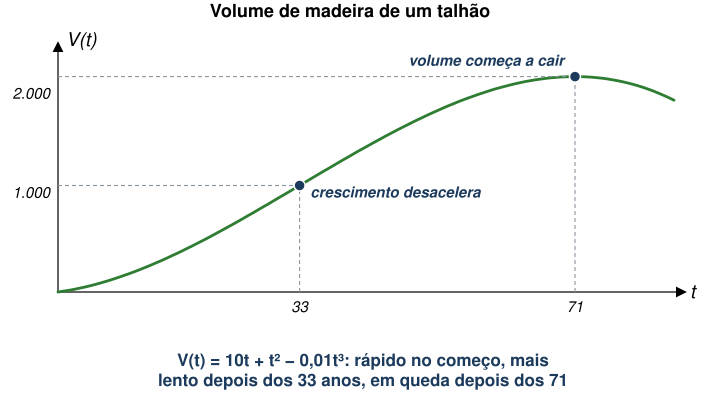
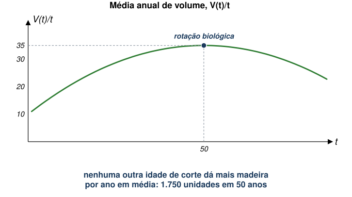
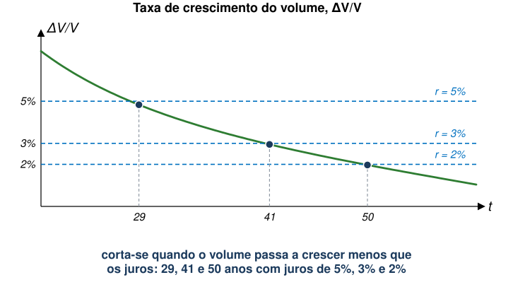
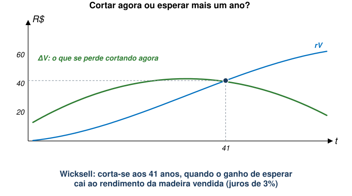
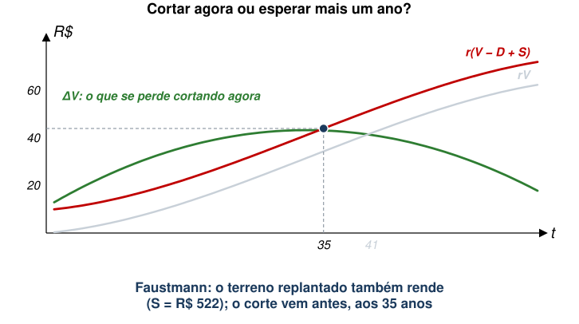
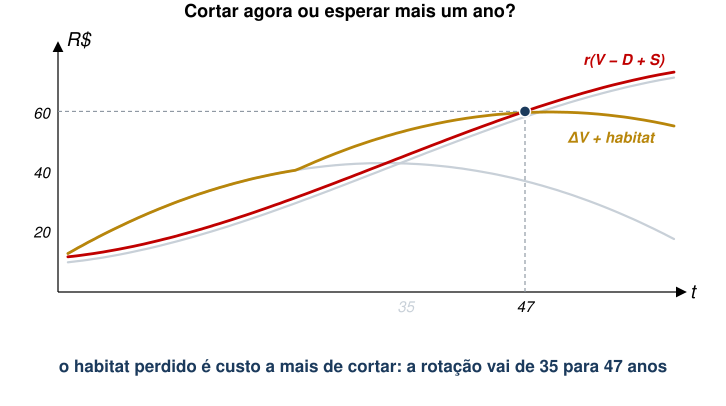
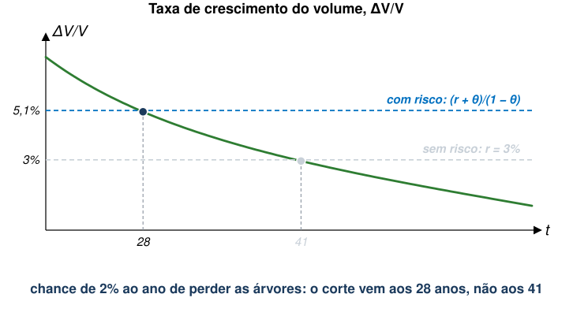
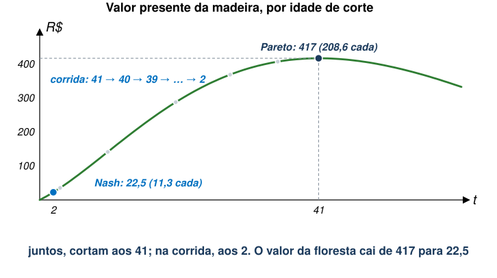
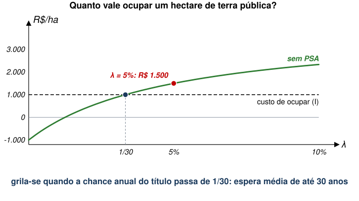
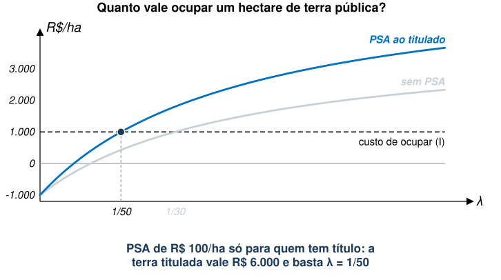

## Aula Passada

- Transição Energética
- Alguns Desafios
  - Volatilidade de preços
- Como induzir transição energética?
  - Caso dos veículos elétricos
- Minerais Críticos
  - Poder de mercado e geopolítica
- Energia de Biomassa
  - Potencial e riscos

## Agenda {style="font-size:0.88em"}

- Recursos Comuns
  - Comportamento estratégico
- Rotação Florestal
  - Rotação biológica, de Wicksell e de Faustmann
  - Benefícios não madeireiros
- Direitos de Propriedade e Desmatamento
  - Risco, corrida entre vizinhos (Nash e Pareto), acesso livre
  - Áreas protegidas e PSA
- Grilagem de Terras
  - Escolha intertemporal e PSA

::: {.no-bullet}
Referência: Keohane e Olmstead (2016), cap. 7
:::

## Recursos Comuns {.section-cover}

## Recursos Comuns

- Nas últimas aulas, não discutimos sobre a alocação de direitos de
  propriedade do recurso natural em questão.
  - Faremos isto focando em "Recursos Comuns".
- A "Tragédia dos Comuns" é um problema clássico em economia.
- Acontece com bens rivais, porém não-excludentes.
  - **Bem rival:** se uma pessoa consome 1 unidade a mais, outra pessoa
    terá 1 unidade a menos disponível.
  - **Não-excludente:** não há mecanismo para evitar que pessoas
    consumam o bem (preço, por exemplo).
- É um problema diferente de "bem público", em que o bem também é
  não-rival.

## Recursos Comuns

- No caso de recursos naturais **renováveis**, há alguns exemplos:
  - Madeira de alto valor em floresta pública;
  - Cabeças de gado em pastagem comum.
- Tipicamente, o resultado de um problema de recursos comuns é a
  **exploração excessiva.**
  - Isto diminui a disponibilidade do recurso, tornando sua extração
    mais cara para todos.
  - Pode-se chegar a uma situação em que a exploração excede a taxa de
    reposição do recurso.

## Comportamento Estratégico {style="font-size:0.86em"}

::: {.no-bullet}
Comportamento predatório em relação a recursos comuns está associado à
**falta de mecanismos de cooperação.**
:::

- Isto remete ao arcabouço teórico de Jogos Não-Cooperativos.

::: {.no-bullet .solto}
Como viram em cursos de Micro, comportamento estratégico **sem
cooperação** pode levar a resultado ineficiente.
:::

- Exemplo clássico de Teoria dos Jogos: Dilema dos Prisioneiros.
  - Pay-off é anos na prisão.
  - Ambos confessam, mas é o pior resultado para eles.

::: {.tabela}
| | | Dona Florinda: Confessar | Dona Florinda: Negar |
|---|---|---|---|
| **Quico** | Confessar | 2 , 2 | 0 , 5 |
| | Negar | 5 , 0 | 1 , 1 |
:::

## Estratégia e Meio Ambiente

::: {.no-bullet}
**Exemplos:**
:::

- Redução de emissões e acordos internacionais.
  - Signatários e não-signatários se beneficiam.
  - Apenas signatários pagam custo → por que assinar então?
- Uso de carro e poluição do ar.
  - Provavelmente, bem-estar aumentaria se menos pessoas usassem carro.
  - Mas, individualmente, benefício líquido pode ser menor.
- Madeira em floresta sem dono seguro.
  - Valeria mais deixar as árvores crescerem.
  - Mas quem espera arrisca ver outro cortar antes. Todos cortam cedo
    demais.

## Recursos que Crescem

::: {.no-bullet}
Muitos recursos renováveis são de **acesso livre** ou de **propriedade
comum**.
:::

- Sem direitos de propriedade, não se espera uso dinamicamente eficiente
  quando os mercados agem sozinhos.

::: {.no-bullet .solto}
Além disso, o estoque de um recurso renovável é limitado, mas não é
fixo.
:::

- O volume de madeira de uma floresta depende da idade das árvores e de
  quando se corta.
- No caso do petróleo, buscava-se a taxa eficiente de extração. Aqui, busca-se
  o momento eficiente da colheita.
- Os modelos combinam biologia e economia: são **modelos
  bioeconômicos**.

## Rotação Florestal {.section-cover}

## Árvores como Ativo de Capital {style="font-size:0.95em"}

::: {.no-bullet}
Árvores em pé são **ativos de capital**, que ganham valor à medida que
crescem em volume.
:::

- Mas deixá-las em pé tem custo de oportunidade de
  investimentos alternativos.
- Busca-se o intervalo entre colheitas que maximiza a diferença entre
  benefícios e custos totais, em valor presente.

::: {.no-bullet .solto}
Duas diferenças em relação aos recursos não-renováveis:
:::

- O valor de uma floresta pode ir além da madeira: habitat de espécies,
  sumidouro de carbono.
- Florestas têm regimes de propriedade variados, desde propriedade privada
  a acesso livre.

## Crescimento da Floresta

::: {.no-bullet}
Volume de madeira de um talhão de árvores homogêneas como função do
tempo:
:::

::: {.eq-block}
$$V(t) = 10t + t^2 - 0{,}01t^3$$
:::

::: {.diagram}
{style="height:330px;max-height:330px"}
:::

## Rotação Biológica

::: {.no-bullet}
Esta rotação se baseia na idade de corte que maximiza o
**incremento médio anual**, $V(t)/t$.
:::

::: {.diagram}
{style="height:330px;max-height:330px"}
:::

- Esta rotação dá o maior volume médio de madeira.

## Rotação Biológica

::: {.no-bullet}
A rotação biológica maximiza o volume de madeira, mas não necessariamente o
benefício líquido do talhão para a sociedade.
:::

- Afinal, nenhuma informação econômica entrou no problema.
- Cortar aos 40 anos em vez de 50: menos madeira, mas recebida 10 anos
  antes.

::: {.no-bullet .solto .fragment fragment-index=1}
Primeiro passo: suponha uma única colheita, ignorando o que acontece com a
terra depois.
:::

- É um problema de "envelhecimento ótimo", parecido com o de quanto
  tempo envelhecer um vinho ou um queijo.
- A resposta depende do retorno de investimentos alternativos: a taxa
  de juros.

## Rotação de Wicksell {style="font-size:0.95em"}

::: {.no-bullet}
A cada ano, compara-se o retorno líquido de cortar agora com o de
esperar mais um ano.
:::

::: {.eq-block}
$$(p-c)\,V(T_0)\,(1+r) = (p-c)\,V(T_1)$$
:::

- $p$: preço da madeira; $c$: custo unitário de corte.
- $V(T_0)$ e $V(T_1)$: volume neste ano e no próximo; $r$: taxa de
  desconto.

::: {.no-bullet .solto .fragment fragment-index=1}
Rearranjando:
:::

::: {.eq-block .fragment fragment-index=1}
$$\frac{V(T_1)-V(T_0)}{V(T_0)} = \frac{\Delta V}{V(T_0)} = r$$
:::

- [Corta-se quando a taxa de crescimento do volume (o retorno do ativo
  "árvore em pé") se iguala à taxa de juros.]{.fragment
  fragment-index=2}

## Rotação de Wicksell

::: {.no-bullet}
A regra de Wicksell é uma condição de **não arbitragem**, como a regra
de Hotelling.
:::

::: {.diagram}
{style="height:330px;max-height:330px"}
:::

- Juros mais altos $\rightarrow$ rotação mais curta. Com juros acima de 2%, a rotação
  de Wicksell é mais curta que a biológica.

## Rotação de Faustmann

::: {.no-bullet}
Ainda falta, no entanto, o custo da **terra** onde as árvores crescem. O problema da
rotação é, na verdade, um problema de uso da terra.
:::

- A cada ano, as seguinte escolhas são possíveis: cortar e replantar; esperar mais um ano; cortar
  e converter a terra a outro uso (lavoura, loteamento); ou cortar e vender
  a terra.

::: {.no-bullet .solto}
**Valor do terreno** ($S$): valor da terra florestada supondo rotação
eficiente para sempre, ou conversão ao uso mais lucrativo quando a
floresta deixar de sê-lo.
:::

- Ou seja, o preço de terra, como de costume, é o valor presente das suas rendas
  futuras e colocada para seu uso mais lucrativo.

## Rotação de Faustmann

::: {.no-bullet}
Com o valor do terreno ($S$) e o custo de replantio ($D$):
:::

::: {.eq-block}
$$(p-c)\,V(T_0) - D + S = \frac{(p-c)\,[V(T_0)+\Delta V] - D + S}{1+r}$$
:::

- $S$ entra dos dois lados: é o preço de venda da terra logo após o
  replantio.
- Mesmo sem intenção de vender, $S$ é o custo de oportunidade de manter
  a terra em floresta.

## Rotação de Faustmann

::: {.no-bullet}
Medindo $V$ pelo valor líquido, $(p-c)V$, a equação vira:
:::

::: {.eq-block}
$$r\,[V(T_0)-D] + rS = \Delta V$$
:::

- À esquerda, o benefício marginal de cortar agora; à direita, o custo
  marginal (crescimento sacrificado).

::: {.no-bullet .solto .fragment fragment-index=1}
Rearranjando:
:::

::: {.eq-block .fragment fragment-index=1}
$$r = \frac{\Delta V}{V(T_0)-D+S}$$
:::

- O retorno é medido sobre o valor da terra florestada, não só da
  madeira: $S$ no denominador. Esta é a **regra de Faustmann**.

## Wicksell em Números

::: {.no-bullet}
Hipóteses: preço líquido de R\$ 1 por unidade e juros de 3% ao ano.
:::

::: {.diagram}
{style="height:340px;max-height:340px"}
:::

- $rV$: o que a madeira vendida renderia no banco em um ano.
- Aos 41 anos, $rV$ = 42,1 já supera $\Delta V$ = 41,3: corta-se.

## E quanto vale o terreno? {style="font-size:0.92em"}

::: {.no-bullet}
$S$: valor da terra logo após o replantio, com corte a cada período de $T$ anos,
para sempre.
:::

- Daqui a $T$ anos, recebe-se $V(T) - D$ (madeira menos replantio) e a
  terra volta a valer $S$.

::: {.eq-block}
$$S = \frac{V(T) - D + S}{(1+r)^T}$$
:::

::: {.no-bullet .solto .fragment fragment-index=1}
Isolando $S$:
:::

::: {.eq-block .fragment fragment-index=1}
$$S = \frac{V(T) - D}{(1+r)^T - 1}$$
:::

- É o valor presente de $V(T) - D$ recebido a cada $T$ anos, para
  sempre.

## E quanto vale o terreno?

::: {.no-bullet}
Hipótese adicional: replantio custa R\$ 200. O valor do terreno, então, depende da
rotação escolhida.
:::

::: {.tabela}
| Rotação, *T* | Madeira, *V*(*T*) | Terreno, *S* |
|---|---|---|
| 25 anos | 719 | R\$ 474 |
| 30 anos | 930 | R\$ 511 |
| **35 anos** | **1.146** | **R\$ 522** |
| 41 anos (Wicksell) | 1.402 | R\$ 509 |
| 50 anos (biológica) | 1.750 | R\$ 458 |
:::

- Com $T$ = 35: $S = (1.146{,}25 - 200)/(1{,}03^{35} - 1) =
  946{,}25/1{,}8139$ = R\$ 522.
- Ou seja, a rotação de Faustmann é a que maximiza o valor do
  terreno.

## Faustmann em Números

::: {.no-bullet}
Com $S$ = R\$ 522, compara-se $r(V - D + S)$ com $\Delta V$.
:::

::: {.diagram}
{style="height:340px;max-height:340px"}
:::

- A curva $rV$ sobe $r(S-D) = 0{,}03 \times 321{,}7$ = R\$ 9,65.
- Aos 35 anos, $r(V-D+S)$ = 44,0 supera $\Delta V$ = 43,2:
  corta-se.

## Três Rotações

::: {.no-bullet}
Em geral, a rotação de Faustmann é a mais curta das três.
:::

::: {.tabela}
| Rotação | Critério | Idade de corte |
|---|---|---|
| Biológica | máximo do volume médio anual | 50 anos |
| Wicksell | crescimento do volume = juros | 41 anos |
| Faustmann | retorno sobre madeira e terra = juros | 35 anos |
:::

::: {.fonte}
Juros de 3% ao ano, preço líquido de R\$ 1 por unidade de volume,
replantio de R\$ 200.
:::

- Esperar um ano adia a colheita atual e **todas as colheitas
  futuras**. $S$ captura esse custo.
- Faustmann descreveu a regra em 1849. 

## Benefícios Não Madeireiros

::: {.no-bullet}
Florestas oferecem benefícios além da madeira: habitat de espécies,
proteção de bacias hidrográficas, sequestro de carbono, recreação.
:::

- Os benefícios podem puxar o tempo de corte ótimo em direções opostas.
  - Um pica-pau ameaçado do sul dos EUA prefere florestas maduras, de 60
    a 180 anos.
  - O veado-de-cauda-branca prefere brotos novos e sub-bosque.

::: {.no-bullet .solto}
Exemplo: habitat de aves que só existe em talhões velhos.
:::

- O habitat perdido entra como **custo adicional de cortar**: além do
  crescimento sacrificado ($\Delta V$), perde-se o habitat ($H$).

## Benefícios Não Madeireiros

::: {.no-bullet}
Habitat que vale R\$ 1 por ano para cada ano de idade do talhão acima de
25:
:::

::: {.diagram}
{style="height:340px;max-height:340px"}
:::

- Com o dobro desse valor, a rotação ótima é infinita: nunca
  cortar.

## Direitos de Propriedade e Desmatamento {.section-cover}

## Desmatamento

::: {.no-bullet}
Segundo a FAO, o mundo perdeu 13 milhões de hectares de floresta por ano
entre 2000 e 2010. As maiores perdas líquidas estão nos trópicos.
:::

- Países do norte restringiram a extração de madeira, em parte pelos
  valores não madeireiros. O preço mundial da madeira subiu.
- Isso aumentou o incentivo a desmatar nos trópicos, menos regulados.

::: {.no-bullet .solto}
Com terra privada e mercados completos, parte do desmatamento é uso
eficiente de um recurso escasso: a terra.
:::

- Proprietários comparam retorno de usos com floresta, lavoura, turismo etc.

## Quem é dono das florestas?

::: {.tabela}
| Região | Florestas públicas |
|---|---|
| EUA (2008) | 44% (56% privadas) |
| África | cerca de 83% |
| Sul e Sudeste Asiático | 92% |
:::

::: {.no-bullet .solto}
Dois fatores enquadram o desmatamento do ponto de vista econômico:
:::

- **Direitos de propriedade:** quem decide sobre a floresta e com que
  segurança.
- **Bens públicos:** habitat, proteção de bacias e carbono não são
  pagos ao proprietário. Proprietários privados cortam rápido demais e
  oferecem menos desses serviços do que o eficiente.

## Direitos de Propriedade

::: {.no-bullet}
Direitos bem definidos importam ainda mais em florestas, porque
rotações ótimas podem ser muito longas.
:::

- Como garantir que uma árvore de madeira de lei deixada em pé hoje
  esteja lá daqui a 50 anos, se sua venda alimenta uma família por
  meses?
- Mesmo onde o governo estabelece direitos sobre a floresta, o
  incentivo a roubar árvores é muito alto.

::: {.no-bullet .solto}
Gestão eficiente da floresta depende de conseguir regular quem corta
e quando.
:::

- Como esse risco entra na regra de corte?

## Árvores sem direitos garantidos

::: {.no-bullet}
Suponha que, a cada ano, há uma chance $\theta$ de perder árvores por conta de extração ilegal. Assim, esperar um ano rende só $(1-\theta)$ da madeira do ano seguinte.
:::

::: {.eq-block}
$$V(T_0)\,(1+r) = (1-\theta)\,V(T_1)$$
:::

- $V$ medido pelo valor líquido; com $\theta = 0$, é a regra de
  Wicksell.

::: {.no-bullet .solto .fragment fragment-index=1}
Rearranjando:
:::

::: {.eq-block .fragment fragment-index=1}
$$\frac{\Delta V}{V(T_0)} = \frac{r+\theta}{1-\theta} \approx r + \theta$$
:::

- [O risco de perder as árvores age como **juros mais altos**: corta-se
  antes.]{.fragment fragment-index=2}

## Árvores sem direitos garantidos

::: {.no-bullet}
Juros de 3% ao ano e chance de 2% ao ano de perder as árvores.
:::

::: {.diagram}
{style="height:330px;max-height:330px"}
:::

- A rotação de Wicksell cai de 41 para 28 anos. Um título seguro reduz
  $\theta$ e alonga a rotação.

## Uma floresta com dois vizinhos

::: {.no-bullet}
De onde vem o risco $\theta$? Muitas vezes, de quem tem acesso à mesma
floresta.
:::

- Suponha que dois vizinhos tenham acesso ao mesmo talhão, e nenhum pode impedir o outro
  de cortar.
- Quem corta primeiro leva toda a madeira. Se os dois cortam no mesmo
  ano, dividem.

::: {.no-bullet .solto}
Hipóteses: (i) volume $V(t)$; (ii) preço líquido de R\$ 1; (iii) juros de 3% ao
ano; e (iv) apenas um corte.
:::

- Quando cada um corta? Quando deveriam cortar?

## A Alocação de Pareto

::: {.no-bullet}
Se decidissem juntos, maximizariam o valor da madeira: é a rotação de
Wicksell.
:::

- Corte aos 41 anos: $V(41)$ = 1.402.
- Qualquer divisão desses 1.402 é eficiente de Pareto: não há como
  melhorar um vizinho sem piorar o outro.
- Dividindo igualmente, por exemplo, cada um fica com 701 aos 41 anos, ou R\$ 208,6 em valor
  presente.

::: {.no-bullet .solto .fragment fragment-index=3}
Mas a cooperação se sustenta?
:::

## Função Melhor-Resposta

::: {.no-bullet}
Dado que o vizinho (Agente 2) vai esperar até os $T$ anos, qual é a melhor resposta do Agente 1? Esperar e dividir, ou
cortar um ano antes e levar tudo?
:::

::: {.eq-block}
$$\underbrace{V(T-1)\,(1+r)}_{\text{cortar antes, sozinho}}
\quad\text{contra}\quad
\underbrace{\tfrac{1}{2}\,V(T)}_{\text{esperar e dividir}}$$
:::

- Os dois lados medidos no ano $T$: a madeira cortada um ano antes rende
  juros.
- Se o Agente 2 espera até 41, cortar aos 40 dá $1.360 \times 1{,}03$ =
  1.400,8, ao passo que esperar e dividir dá 700,9.
- Ou seja, a melhor resposta a esperar até 41 é cortar aos
  40.

## Corrida pelas árvores

::: {.no-bullet}
A melhor resposta do Agente 2, no entanto, é antecipar e cortar aos 39. Então, a melhor resposta do Agente 1 passa a ser 38. E
assim por diante.
:::

::: {.tabela}
| Idade de corte do vizinho | Cortar um ano antes, sozinho | Esperar e dividir | Melhor resposta |
|---|---|---|---|
| 41 anos | 1.400,8 | 700,9 | 40 anos |
| 28 anos | 826,2 | 422,2 | 27 anos |
| 10 anos | 168,6 | 95,0 | 9 anos |
| 3 anos | 24,6 | 19,4 | 2 anos |
| 2 anos | 11,3 | 12,0 | 2 anos |
:::

::: {.fonte}
Valores estão medidos no ano em que o outro corta; juros de 3% ao ano.
:::

- A corrida só para aos 2 anos: os dois cortam e dividem $V(2)$ = 23,9.
  É o **equilíbrio de Nash**.

## Nash contra Pareto

::: {.no-bullet}
Curva do valor da madeira vai se deslocando para baixo com a corrida.
:::

::: {.diagram}
{style="height:300px;max-height:300px"}
:::

- No fim, cada um recebe R\$ 11,3 em valor presente sem cooperação, contra
  R\$ 208,6 com cooperação. 

## O Risco Vem do Vizinho

::: {.no-bullet}
A condição para antecipar é a regra das árvores sem direito garantido, com
$\theta = 1/2$:
:::

::: {.eq-block}
$$V(T_0)\,(1+r) = (1-\theta)\,V(T_1), \qquad \theta = \tfrac{1}{2}$$
:::

- Esperar um ano rende só metade da madeira do ano seguinte: a outra
  metade fica com o vizinho.
- O equilíbrio com $T=2$ na corrida corresponde à coluna de $\theta$ = 50% na tabela a
  seguir.

## Acesso Livre na Floresta

::: {.no-bullet}
Com muitos vizinhos, a árvore é de quem cortar primeiro: **acesso
livre**. Esperar só rende a quem tem a colheita garantida.
:::

::: {.tabela}
| Chance anual de perder as árvores, *θ* | 0 | 2% | 10% | 50% (dois vizinhos) |
|---|---|---|---|---|
| Idade de corte | 41 anos | 28 anos | 11 anos | 2 anos |
:::

::: {.fonte}
Juros de 3% ao ano; volume $V(t)$ desta aula.
:::

- Com $\theta$ perto de 1, corta-se assim que houver madeira para
  vender.
- Ninguém replanta: quem paga o replantio ($D$) não colhe. Para quem
  usa a floresta, o terreno vale $S = 0$.

::: {.no-bullet .solto}
É a **tragédia dos comuns**, em que cada um corta cedo demais porque, se esperar,
o vizinho corta. A renda da terra florestada se perde.
:::

## Propriedade Comum Não É Acesso Livre {style="font-size:0.9em"}

::: {.no-bullet}
**Acesso livre:** nenhuma restrição a quem usa o recurso ou a quanto
extrai. 
**Propriedade comum:** recurso compartilhado por um grupo (uma
vila, por exemplo), sob regras formais ou normas informais.
:::

::: {.no-bullet .solto .fragment fragment-index=2}
Arranjos bem-sucedidos dependem da autorregulação dos usuários, que
evitam agir de forma oportunista [@ostrom1990].
:::

- Uma floresta comunitária com regras de corte reduz $\theta$ para
  todos: cada um espera, porque os outros também esperam.
- Na corrida entre vizinhos, uma regra de não cortar antes dos 41 leva
  à alocação de Pareto.

## Direitos de Propriedade

::: {.no-bullet}
No entanto, direitos mais seguros também aumentam o retorno de usos da
terra que competem com a floresta.
:::

- Nicarágua: a reforma de titulação aumentou o desmatamento, porque
  estimulou investimento na agricultura [@liscow2013].
- Em Faustmann: a terra em lavoura passa a valer mais que em floresta.

::: {.no-bullet .solto}
Ou seja, direitos de propriedade sozinhos não bastam. Duas respostas
comuns:
:::

- **Áreas protegidas:** a floresta fica pública, com limites fortes ao
  corte.
- **Pagamento por serviços ambientais (PSA):** internaliza a
  externalidade positiva da preservação, pagando para manter a floresta
  em pé.

## Áreas Protegidas {style="font-size:0.94em"}

::: {.no-bullet}
Primeira resposta. No modelo de rotação, uma área protegida é a rotação
infinita imposta por lei: nunca cortar.
:::

- **Fiscalização:** o incentivo privado a cortar continua dentro da
  área. Sem fiscalização, ela vira floresta sem dono seguro, com
  $\theta$ alto.
- **Adicionalidade:** só evita desmatamento a área que estaria
  ameaçada. Muitas foram escolhidas justamente por serem pouco
  ameaçadas.
- **Vazamento:** proteger uma área pode empurrar o desmatamento para o
  entorno.
- **Efeito local:** moradores perdem acesso a terra, lenha e caça;
  podem ganhar com água protegida e ecoturismo.

::: {.no-bullet .solto}
Ou seja, proteger no papel não basta: a área precisa ser fiscalizada e
estar onde o desmatamento aconteceria.
:::

## PSA no México

::: {.no-bullet}
Segunda resposta. Desde 2003, o governo do México paga proprietários
para manter a cobertura florestal.
:::

- Objetivo: proteger bacias hidrográficas e a recarga de aquíferos,
  melhorar a água das comunidades a jusante; também aliviar a pobreza
  rural.
- Contratos de 5 anos, financiados por taxas pagas pelos usuários de
  água.
- Seleção por pontos (risco de desmatamento, escassez de água, pobreza).
  Monitoramento por satélite e vistoria.

::: {.tabela}
| Programa de Pagamentos por Serviços Hidrológicos | |
|---|---|
| Área inscrita, 2003 a 2011 | 2,6 milhões de hectares |
| Perda de cobertura florestal evitada, 2003 a 2012 | 40% a 51% |
:::

::: {.fonte}
Fonte: @alixgarcia2015, citado por @keohane2016. 
:::

## Grilagem de Terras {.section-cover}

## O que É Grilagem?

::: {.no-bullet}
Grilagem: toda ação que visa obter a posse ou a propriedade da terra por
meio de ato ilícito.
:::

- Exemplo: desmatar floresta pública para demonstrar ocupação.

::: {.no-bullet .solto}
O ciclo descrito para a Amazônia:
:::

- Invasão de terra pública → desmatamento → anistia à ocupação ilegal →
  título.
- Titular área recém-desmatada funciona como prêmio, não como punição.

::: {.no-bullet .solto}
No México, o PSA paga a proprietários. E quando não está claro quem é o
dono?
:::

::: {.fonte}
Fonte: @brito2021.
:::

## Grilagem em Números

::: {.tabela}
| Amazônia | |
|---|---|
| Florestas públicas não destinadas | 56 milhões de hectares |
| Parcela registrada no CAR como imóvel privado | cerca de um quarto |
| Desmatamento anual que ocorre em florestas não destinadas | de 12% (2016) para 32% (2020) |
| Área do CAR com mais de uma reivindicação, 2021 | 16% (35,4 milhões de hectares) |
| Preço da terra pública vendida, em relação ao mercado | 15% (estados) e 26% (União) |
:::

::: {.fonte}
Fontes: @furumo2024; preço da terra, @brito2021.
:::

## Prazos que Mudam

::: {.no-bullet}
As leis de regularização definem até quando uma ocupação de terra
pública pode ser titulada. Esse prazo muda.
:::

- 2017 (Lei 13.465): o prazo federal passou de 2004 para 2011.
- 2019 (MP 910): tentativa de levar o prazo a 2018; a medida perdeu a
  validade.
- 2023 (Decreto 11.866): a União não pode titular florestas públicas; o
  CAR precisa ser validado antes do título.

::: {.no-bullet .solto}
Ou seja, prazos já alterados criam a expectativa de que terra ocupada e
desmatada hoje seja legalizada no futuro.
:::

::: {.fonte}
Fontes: @brito2021; @furumo2024.
:::

## O CAR e a Grilagem

::: {.no-bullet}
O Cadastro Ambiental Rural (CAR), de 2012, é autodeclaratório: o próprio
ocupante informa os limites do imóvel.
:::

- Criado para monitorar o Código Florestal, não para servir de título.
- Passou a servir de "prova" de posse, acompanhado de desmatamento para
  demonstrar ocupação.
- Em 2021, metade dos imóveis cadastrados na Amazônia Legal tinha ao
  menos uma reivindicação concorrente. Nessas terras, o desmatamento é
  maior [@furumo2024].

::: {.no-bullet .solto}
Terra pública sem destinação se aproxima do acesso livre: a corrida não
é só pela madeira, mas pela própria terra.
:::

## Grilar É uma Escolha Intertemporal

::: {.no-bullet}
Versão simplificada de um modelo de opções reais
[Pereira et al., -@pereira2026]: quem grila decide hoje se vale ocupar.
:::

- **Hoje:** custo de ocupar, $I$: desmatar a área mínima que demonstra a
  posse.
- **Enquanto espera:** lucro anual da ocupação, $\pi_G$. Pode ser
  negativo: o uso da terra é ilegal e sujeito a multa.
- **Prêmio incerto:** a cada ano, o título chega com probabilidade
  $\lambda$. A terra titulada vale $W_O$.

::: {.no-bullet .solto}
É a mesma família de problemas das rotações: escolher o momento de agir
quando o retorno vem no futuro.
:::

- Lá, a chance $\theta$ de perder as árvores; aqui, a chance $\lambda$
  de ganhar a terra.

## Quanto Vale uma Posse?

::: {.no-bullet}
Valor da posse hoje, $W_G$: lucro do ano mais o que a terra vale no ano
seguinte, descontado.
:::

::: {.eq-block}
$$W_G = \frac{\pi_G + \lambda\, W_O + (1-\lambda)\, W_G}{1+r}$$
:::

- Com probabilidade $\lambda$, vira terra titulada; com $1-\lambda$,
  continua posse.

::: {.no-bullet .solto .fragment fragment-index=1}
Isolando $W_G$:
:::

::: {.eq-block .fragment fragment-index=1}
$$W_G = \frac{\pi_G + \lambda\, W_O}{r + \lambda}$$
:::

- [Grila-se se $W_G \geq I$.]{.fragment fragment-index=2}

## Um Exemplo Numérico

::: {.tabela}
| Parâmetro | Valor |
|---|---|
| Juros, *r* | 5% ao ano |
| Chance anual de título, *λ* | 5% (espera média de 20 anos) |
| Terra titulada, *W~O~* | R\$ 4.000/ha (renda de R\$ 200/ha por ano) |
| Lucro da ocupação, *π~G~* | −R\$ 50/ha por ano |
| Custo de ocupar, *I* | R\$ 1.000/ha |
:::

- $W_G = (-50 + 0{,}05 \times 4.000)/(0{,}05+0{,}05) = 1.500 > 1.000$:
vale grilar.
- Sem chance de título ($\lambda = 0$): $W_G = -50/0{,}05 = -1.000$.
  Não há grilagem.
- Ou seja, grilagem não depende de lucro com a produção, mas, sim, do retorno
  esperado do título de posse.

## A probabilidade de titulação

::: {.no-bullet}
Quanto maior a probabilidade anual de titulação, maior o valor da posse.
:::

::: {.diagram}
{style="height:320px;max-height:320px"}
:::

- Prazos de regularização que mudam elevam $\lambda$ para quem ocupa
  hoje.

## O que Aumenta a Grilagem?

::: {.no-bullet}
Pela fórmula, $W_G$ sobe quando:
:::

- **$\pi_G$ sobe:** punição menor pelo uso ilegal; preço agrícola ou
  produtividade maiores.
- **$W_O$ sobe:** terra mais cara. Vender terra pública a 15% ou 26% do
  valor de mercado aumenta o prêmio líquido do título.
- **$\lambda$ sobe:** sempre que $\pi_G < rW_O$, o que vale quando
  $\pi_G < 0$.

## PSA e Grilagem

::: {.no-bullet}
Quando os direitos de propriedade não são bem definidos, o PSA pode
incentivar a grilagem.
:::

- Seja $\psi$ o pagamento anual por hectare de floresta mantida, pago a
  quem tem título.
- A renda da terra titulada sobe $\psi$; seu valor sobe $\psi/r$.

::: {.no-bullet .solto}
O prêmio do título aumenta: vale mais ocupar hoje à espera dele.
:::

## PSA ao Titulado

::: {.no-bullet}
Com $\psi$ = R\$ 100/ha por ano, $W_O$ vai de R\$ 4.000 para
R\$ 6.000.
:::

::: {.diagram}
{style="height:320px;max-height:320px"}
:::

- A espera média tolerada pelo título vai de 30 para 50 anos.

## PSA e Grilagem

::: {.no-bullet}
PSA eficiente pressupõe saber quem é o dono.
:::

- O PSA aumenta o valor de manter a floresta: para o dono seguro, faz o
  papel do habitat e alonga a rotação. Sem direitos definidos, aumenta
  também o valor de **reivindicar** a terra. Reivindicar, por sua vez,
  exige desmatar.
- Um prazo de regularização crível ($\lambda = 0$ para ocupações novas)
  desfaz o efeito: $W_O$ deixa de entrar em $W_G$.

::: {.no-bullet .solto}
Ou seja, pagar a quem usa um recurso sem dono atrai entrada. Na
floresta, entrar é desmatar.
:::

## Concluindo

- Árvores em pé são ativos de capital: corta-se quando o crescimento do
  valor iguala os juros. Com o valor da terra (Faustmann), o corte vem
  antes.
- Benefícios não madeireiros alongam a rotação e podem torná-la
  infinita.
- Sem direitos seguros, o risco de perder as árvores age como juros mais
  altos. No acesso livre, corta-se cedo e ninguém replanta.
- Dois vizinhos no mesmo talhão correm para cortar: o Nash é cortar aos
  2 anos; a alocação de Pareto, esperar até 41.
- Direitos de propriedade importam, mas não bastam: o título também
  valoriza usos que competem com a floresta.
- Com direitos mal definidos, grilar é apostar no título. O PSA pode
  aumentar o prêmio dessa aposta.

## Referências

::: {#refs style="column-count:2; column-gap:1.6em; font-size:0.8em"}
:::
