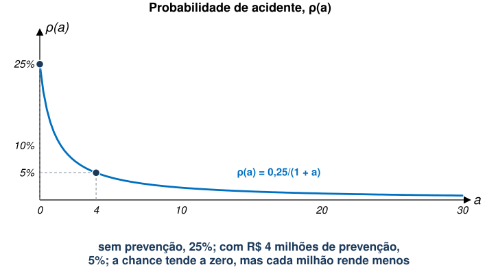
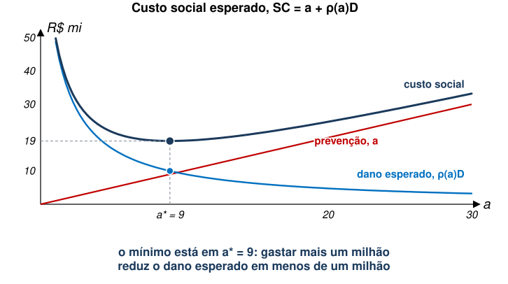
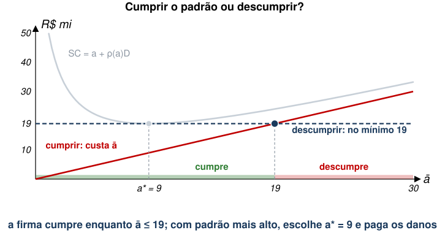
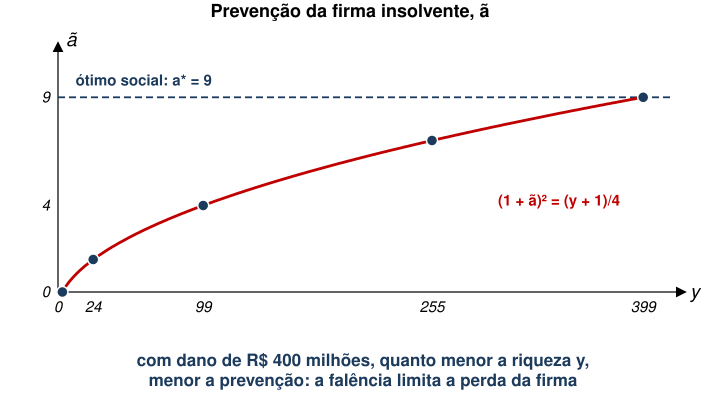

## Aula Passada

- Recursos Comuns
  - Comportamento estratégico
- Rotação Florestal
  - Rotação biológica, de Wicksell e de Faustmann
- Direitos de Propriedade e Desmatamento
  - Corrida entre vizinhos, acesso livre
- Grilagem de Terras

## Agenda {style="font-size:0.88em"}

- Acidentes vs. Poluição Contínua
- Modelo Básico
  - Probabilidade de Acidente
  - Dano Esperado
  - Custos de Produção e Prevenção
  - Ótimo Social
  - Firma sem Responsabilização Ambiental
- Regras de Responsabilização Ambiental
  - Responsabilização Total
  - Regra da Negligência
- Responsabilização com Seguro

::: {.no-bullet}
Referência: Phaneuf e Requate, cap. 10
:::

## Acidentes vs. Poluição Contínua

::: {.no-bullet}
Os modelos que vimos até agora lidam com poluição contínua.
:::

- São firmas cuja atividade produtiva gera poluentes de forma regular.
- Muitas vezes, entretanto, danos ambientais advêm de acidentes graves:
  - Vazamento de petróleo na costa brasileira em 2019;
  - Rompimento das barragens do Fundão (2015) e Córrego do Feijão (2018);
  - Acidente nuclear de Chernobyl (1986);
  - Acidente nuclear de Fukushima (2011).
- Em caso de acidentes, a atividade da firma não é necessariamente
  poluidora.
  - No entanto, o acidente em si é extremamente danoso ao meio ambiente
    e à saúde da comunidade.

## Acidentes vs. Poluição Contínua

::: {.no-bullet}
Chamaremos esses acidentes de **eventos discretos**, em oposição à
**poluição contínua**.
:::

::: {.no-bullet .solto}
Abordagem regulatória será diferente aqui.
:::

- Não se trata de taxar a atividade poluidora.
- É preciso incentivar esforços para **prevenção de acidentes**.
  - Acidentes que, talvez, nunca venham a ocorrer.
- Além disso, há o **pagamento de multas** no caso de acidente.
  - Tamanho da multa pode afetar comportamento da firma de forma
    inesperada.

## Modelo Básico {.section-cover}

## Probabilidade de Acidente

::: {.no-bullet}
Por conta da natureza diferente do problema, usaremos um modelo ligeiramente diferente.
:::

::: {.no-bullet .solto}
Denote $\rho(a)$ como a probabilidade de ocorrência de um acidente.
:::

- Em que $a$ é o nível de prevenção adotado.

::: {.no-bullet .solto}
Probabilidade decresce com mais prevenção, mas a taxas decrescente.
:::

- $\rho'(a)<0$ e $\rho''(a)>0$.
- Além disso, temos $\lim_{a\to \infty} \rho(a)=0$.

## Um Exemplo Numérico

::: {.no-bullet}
Ao longo da aula: $\rho(a) = 0{,}25/(1+a)$, com $a$ em R\$ milhões.
:::

::: {.diagram}
{style="height:330px;max-height:330px"}
:::

- $\rho'(a) = -0{,}25/(1+a)^2 < 0$ e $\rho''(a) = 0{,}5/(1+a)^3 > 0$.
- Sem prevenção, $\rho(0)$ = 25%. Com $a$ = 4, $\rho(4) = 0{,}25/5$ =
  5%.

## Dano Esperado

- Trataremos o dano ambiental como um valor exógeno igual a $D$.
  - Quando não há acidente, o dano é igual a zero.
- Assim, o valor esperado do dano ambiental é dado por:

::: {.eq-block}
$$EV(Dano)=\rho(a)\cdot D+\left[1-\rho(a)\right]\cdot 0=\rho(a)D$$
:::

::: {.no-bullet .solto}
No exemplo, $D$ = R\$ 400 milhões.
:::

- Sem prevenção: $0{,}25 \times 400$ = R\$ 100 milhões de dano
  esperado.
- Com $a$ = 4: $0{,}05 \times 400$ = R\$ 20
  milhões.

## Custos de Produção e Prevenção

- Considere $x$ como o bem produzido pela firma, com risco de acidente.
  - Focaremos em **apenas uma firma**;
  - $P(x)$ é a demanda inversa pelo bem $x$.
- O custo da firma é uma combinação de custo de produção com custo de
  prevenção ("abatimento").
  - $C(x,a)$
- Custos crescentes em produção e prevenção:
  - $C_{x}(x,a)=\frac{\partial C}{\partial x}>0$ e
    $C_{a}(x,a)=\frac{\partial C}{\partial a}>0$.
- Além disso, assumimos o seguinte:
  - $C_{xx}(x,a)\geq 0$ ; $C_{aa}(x,a)\geq 0$ ;
    $C_{ax}(x,a)=C_{xa}(x,a)\geq 0$.

## Ótimo Social

- O bem-estar social é função de $x$ e $a$:

::: {.eq-block}
$$SW(x,a)=\int_{0}^{x} P(t)\,dt-C(x,a)-\rho(a)D$$
:::

- O regulador escolhe $x$ e $a$ para maximizar $SW(x,a)$:
  $\max_{x,a} SW(x,a)$.
- E as CPOs são:

::: {.eq-block}
$$P(x)=C_{x}(x,a) \qquad\qquad -\rho'(a)D=C_{a}(x,a)$$
:::

- Na primeira, benefício Mg de $x$ = CMg de $x$.
- Na segunda, dano **esperado** Mg = CMg de prevenção ($a$).

## Algumas Simplificações

::: {.no-bullet}
Para seguirmos, vamos simplificar um pouco a função de custo.
:::

- Assuma que o custo de produção é independente do custo de
  prevenção.
- Assuma também uma função quase-linear para que o esforço de
  prevenção esteja em unidades monetárias.

::: {.eq-block}
$$C(x,a)=C(x)+a$$
:::

::: {.no-bullet .solto}
Isto significa que o bem-estar também será "separável".
:::

## Algumas Simplificações

- Vamos denotar o benefício líquido máximo do bem $x$ como:

::: {.eq-block}
$$b=\max_{x} \int_{0}^{x} P(t)\,dt-C(x)$$
:::

- Logo, temos:

::: {.eq-block}
$$SW(a)=\int_{0}^{x} P(t)\,dt-C(x)-a-\rho(a)D$$
:::

::: {.eq-block}
$$=b-\left[a+\rho(a)D\right]$$
:::

## Algumas Simplificações

- Neste caso, a condição de ótimo social é dada por:

::: {.eq-block}
$$-\rho'(a)D=1$$
:::

- O custo social esperado de um acidente é dado pelo **custo de
  prevenção mais o eventual dano causado pelo acidente:**

::: {.eq-block}
$$SC=a+\rho(a)D$$
:::

## Ótimo Social em Números

::: {.no-bullet}
Com $\rho(a) = 0{,}25/(1+a)$ e $D$ = 400, a condição de ótimo fica:
:::

::: {.eq-block}
$$-\rho'(a)D = \frac{0{,}25 \times 400}{(1+a)^2} = \frac{100}{(1+a)^2} = 1
\;\Rightarrow\; 1 + a^* = 10 \;\Rightarrow\; a^* = 9$$
:::

::: {.tabela}
| Prevenção, $a$ | $\rho(a)$ | Dano esperado, $\rho(a)D$ | Custo social, $a + \rho(a)D$ |
|---|---|---|---|
| 0 | 25% | 100 | 100 |
| 4 | 5% | 20 | 24 |
| **9** | **2,5%** | **10** | **19** |
| 19 | 1,25% | 5 | 24 |
:::

- De 4 para 9, gastam-se 5 milhões a mais e o dano
  esperado cai 10. De 9 para 19, gastam-se 10 a mais, mas o dano cai apenas 5.

## Representação Gráfica

::: {.diagram}
{style="height:380px;max-height:380px"}
:::

- À esquerda de $a^*$, um milhão a mais em prevenção reduz o dano
  esperado em mais de um milhão. À direita, em menos.

## Firma sem Responsabilização Ambiental

- Do lado da firma, na ausência de responsabilização, o lucro é:

::: {.eq-block}
$$\Pi=px-C(x)-a$$
:::

- Definiremos $v=\max_{x} px-C(x)$.
  - Ou seja, o lucro máximo considerando apenas o lado da produção de
    $x$.
- Assim, o lucro se torna, simplesmente, $\Pi=v-a$.

## Firma sem Responsabilização Ambiental

- Qual será a escolha ótima de prevenção da firma neste caso?

::: {.eq-block}
$$\max_{a} \Pi=v-a$$
:::

- [Solução de canto: $\hat{a}=0\neq a^{*}>0$.]{.fragment
  fragment-index=1}
- [Intuitivamente, se não há responsabilização, **a firma não se esforça
  para evitar acidentes**.]{.fragment fragment-index=1}
- [No exemplo: $\rho(0)$ = 25% e custo social de 100, contra 19 no
  ótimo.]{.fragment fragment-index=2}

## Regras de Responsabilização {.section-cover}

## Regras de Responsabilização Ambiental

::: {.no-bullet}
Em se tratando de acidentes ambientais, é relevante discutir o **tamanho da multa em relação aos ativos da firma**.
:::

::: {.no-bullet .solto}
Defina a variável $k$ como o valor dos ativos da firma.
:::

::: {.no-bullet .solto}
A riqueza (*valuation*)  da firma é dada por $y=v+k$.
:::

- Em que $v=\max_{x} px-C(x)$ é o lucro máximo com a venda de $x$.

::: {.no-bullet .solto}
Assim, a **solvência** da firma depende de $y$ e $D$.
:::

- Se $y\geq D$, a firma é solvente diante do acidente;
- Se $y<D$, a firma não é solvente.

## Firma Solvente

::: {.no-bullet}
Estudaremos, primeiro, o caso de uma firma solvente.
:::

- Ou seja, em que temos $y>a+D$.

::: {.no-bullet .solto}
Discutiremos duas regras de responsabilização:
:::

1. Responsabilização Total
2. Regra da Negligência

## Firma Solvente: Responsabilização Total

::: {.no-bullet}
Neste caso, a firma paga por todo o dano causado se houver acidente.
:::

::: {.no-bullet .solto}
Vamos assumir uma firma neutra ao risco: lucro esperado é $EV\left[\Pi(a)\right]=y-a-\rho(a)D$.
:::

::: {.no-bullet .solto}
A condição de maximização é dada por:
:::

::: {.eq-block}
$$-\rho'(a)D=1$$
:::

- É exatamente a escolha socialmente ótima.

::: {.no-bullet .solto}
**[Se a firma é solvente]{.underline}, a responsabilização total leva a
uma escolha socialmente ótima**.
:::

## Firma Solvente: Regra da Negligência

::: {.no-bullet}
Suponha, agora, que o regulador define um nível mínimo de prevenção
igual a $\bar{a}$.
:::

- A firma só é responsabilizável se for comprovado que escolheu um
  nível de prevenção menor do que $\bar{a}$.

::: {.no-bullet .solto}
Considerando uma firma neutra ao risco, temos:
:::

::: {.eq-block}
$$EV\left[\Pi(a)\right]=\begin{cases} y-\left[a+\rho(a)D\right] & \text{se } a<\bar{a} \\ y-a & \text{se } a\geq \bar{a}\end{cases}$$
:::

::: {.no-bullet .solto}
Qual será a escolha ótima?
:::

## Cumprir ou Descumprir? {style="font-size:0.92em"}

::: {.no-bullet}
A firma tem, na prática, duas opções.
:::

- **Cumprir** ($a \geq \bar{a}$): a firma não responde pelo acidente e
  gasta só a prevenção. O mais barato é $a = \bar{a}$.
  - O dano esperado, $\rho(\bar{a})D$, fica com as vítimas.
- **Descumprir** ($a < \bar{a}$): a firma indeniza todo o dano, como na
  responsabilização total. Seu custo esperado é $a + \rho(a)D$, o próprio
  custo social.
  - O menor valor do custo social é $a^* + \rho(a^*)D$ (no exemplo, 19).
    Descumprindo, a firma não gasta menos que isso.

::: {.no-bullet .solto .fragment fragment-index=1}
Logo, a firma cumpre o padrão se:
:::

::: {.eq-block .fragment fragment-index=1}
$$\bar{a} \leq a^* + \rho(a^*)D$$
:::

- [Se cumpre, escolhe $a = \bar{a}$. Se descumpre, escolhe $a = a^*$ e
  paga os danos.]{.fragment fragment-index=2}

## Representação Gráfica

::: {.diagram}
{style="height:380px;max-height:380px"}
:::

- No exemplo, $a^* + \rho(a^*)D = 9 + 10$ = 19.

## Regra da Negligência em Números

::: {.tabela}
| Padrão, $\bar{a}$ | Cumprir custa | Descumprir custa, no mínimo | Escolha | Custo social |
|---|---|---|---|---|
| 4 | 4 | 19 | cumpre: $a$ = 4 | 24 |
| **9** | **9** | **19** | **cumpre: $a$ = 9** | **19** |
| 15 | 15 | 19 | cumpre: $a$ = 15 | 21,25 |
| 25 | 25 | 19 | descumpre: $a$ = 9 | 19 |
:::

::: {.fonte}
Custo social de $a$ = 15: $15 + 100/16$ = 21,25.
:::

- $\bar{a} = a^*$: a firma escolhe o ótimo, como na responsabilização
  total.
- $\bar{a} < a^*$: a firma cumpre, mas previne pouco. Entre $a^*$ e 19,
  previne demais.
- $\bar{a}$ acima de 19: o padrão é ignorado. A firma paga os danos e
  escolhe $a^*$.

## Total ou Negligência?

::: {.no-bullet}
Com $\bar{a} = a^*$, as duas regras levam à mesma prevenção. Muda quem
arca com o dano esperado.
:::

::: {.tabela}
| | Responsabilização total | Negligência, $\bar{a} = a^*$ |
|---|---|---|
| Prevenção | 9 | 9 |
| Gasto esperado da firma | 9 + 10 = 19 | 9 |
| Dano esperado sem compensação | 0 | 10 |
:::

- Na negligência, a firma que cumpre o padrão não indeniza as vítimas.
- Para fixar $\bar{a} = a^*$, o regulador precisa conhecer $\rho(a)$ e
  $D$. Na responsabilização total, a própria firma calcula $a^*$.

## Firma Insolvente {.section-cover}

## Firma Insolvente {style="font-size:0.86em"}

::: {.no-bullet}
Trataremos agora do caso em que a firma pode se tornar insolvente se
tiver que pagar pelos danos ambientais.
:::

::: {.no-bullet .solto}
Note que **só faz sentido estudar este caso se**
$b-a^{*}-\rho(a^{*})D>0$.
:::

- Ou seja, existe algum benefício (esperado) em se produzir $x$.
- Se for menor do que zero, a produção de $x$ não faz sentido
  socialmente.

::: {.no-bullet .solto}
Assumir que há benefício, entretanto, não garante $y-a^{*}-D>0$
(solvência).
:::

::: {.no-bullet .solto}
Ou seja, estamos estudando um caso em que:
:::

- **a produção de** $x$ **faz sentido socialmente *ex-ante*** (antes do
  acidente);
- mas a **firma não consegue cobrir os danos *ex-post*** (após o
  acidente).

## Firma Insolvente: Responsabilização Total

::: {.no-bullet}
Na ausência de mercado de crédito (riqueza da firma não pode ser
negativa), temos:
:::

::: {.eq-block}
$$EV\left[\Pi(a,y)\right]=\rho(a)\cdot \max\left\{0,y-a-D\right\}+[1-\rho(a)](y-a)$$
:::

::: {.no-bullet .solto}
Em palavras:
:::

- Se há acidente, o lucro da firma é, no mínimo, zero.
  - Se firma é insolvente, teríamos $y-a-D<0$.
- Se não há acidente, lucro da firma é $y-a$.

## Firma Insolvente: Responsabilização Total

::: {.no-bullet}
Se firma é insolvente, temos $\max\left\{0,y-a-D\right\}=0$. Logo:
:::

::: {.eq-block}
$$EV\left[\Pi(a,y)\right]=\rho(a)\cdot 0+\left[1-\rho(a)\right](y-a)=\left[1-\rho(a)\right](y-a)$$
:::

::: {.no-bullet .solto .fragment fragment-index=1}
Condição de máximo é:
:::

::: {.eq-block .fragment fragment-index=1}
$$-\rho'(a)(y-a)=1-\rho(a)$$
:::

- [Note que o custo marginal (lado direito) é menor do que quando a
  firma é solvente ($CMg=1$).]{.fragment fragment-index=1}
  - [Isto ocorre porque o custo da prevenção só é relevante quando não
    há acidente.]{.fragment fragment-index=1}
- [O lado esquerdo, no entanto, também diminui: benefício é proporcional à riqueza, não ao dano.]{.fragment fragment-index=1}

## Firma Insolvente: Responsabilização Total

::: {.no-bullet}
Podemos reescrever a CPO e compará-la com a da firma solvente:
:::

::: {.eq-block}
$$\text{solvente: } -\rho'(a^*)=\frac{1}{D} \qquad\qquad \text{insolvente: } -\rho'(\tilde{a})=\frac{1-\rho(\tilde{a})}{y-\tilde{a}}$$
:::

- Lado esquerdo, igual nas duas: quanto um real de prevenção reduz
  $\rho$.
- Lado direito: a redução mínima que faz esse real valer a pena.
- $D$ não aparece na CPO da insolvente: só a riqueza $y$ importa.

::: {.no-bullet .solto}
Nesse caso, $\tilde{a}<a^{*}$?
:::

- [$-\rho'(a)$ é decrescente: $\tilde{a} < a^*$ se o lado direito da
  insolvente passa de $1/D$.]{.fragment fragment-index=1}
- [Sim, se dano for suficientemente grande em relação à riqueza da
  firma.]{.fragment fragment-index=2}

## Firma Insolvente em Números

::: {.no-bullet}
Com $\rho(a) = 0{,}25/(1+a)$, a CPO fica:
:::

::: {.eq-block}
$$\frac{0{,}25\,(y-\tilde{a})}{(1+\tilde{a})^2} = \frac{0{,}75+\tilde{a}}{1+\tilde{a}}$$
:::

::: {.no-bullet .solto}
Multiplicando os dois lados por $(1+\tilde{a})^2$:
:::

::: {.eq-block}
$$0{,}25\,(y-\tilde{a}) = (1+\tilde{a})^2 - 0{,}25\,(1+\tilde{a})
\;\Rightarrow\; (1+\tilde{a})^2 = \frac{y+1}{4}$$
:::

- Com $y$ = 99 (o dano é quatro vezes a riqueza): $(1+\tilde{a})^2$ =
  25, logo $\tilde{a}$ = 4.

## Prevenção e Riqueza

::: {.diagram}
{style="height:380px;max-height:380px"}
:::

- Com $y$ = 99: $\tilde{a}$ = 4, $\rho(4)$ = 5% e custo social de 24,
  contra 19 no ótimo.

## Firma Insolvente: Regra da Negligência

::: {.no-bullet}
Tipicamente, teremos o mesmo resultado: há menos prevenção do que o
socialmente ótimo.
:::

::: {.no-bullet .solto}
No entanto, há uma implicação interessante:
:::

- Se a riqueza da firma for pequena o suficiente, é possível definir
  $\bar{a}$ de modo que a **Regra da Negligência produza resultado mais
  eficiente do que a Responsabilização Total**.

## Negligência com Firma Insolvente

::: {.no-bullet}
As mesmas duas opções, agora com $y$ = 99:
:::

- **Cumprir**: não responde pelo acidente. Fica com $y - \bar{a}$ com
  certeza.
- **Descumprir**: no máximo, repete a escolha da responsabilização
  total, $(1-\rho(4))(99-4) = 0{,}95 \times 95$ = 90,25.

::: {.tabela .fragment fragment-index=1}
| Padrão, $\bar{a}$ | Cumprir rende | Descumprir rende, no máximo | Escolha | Custo social |
|---|---|---|---|---|
| 8 | 99 − 8 = 91 | 90,25 | cumpre: $a$ = 8 | 8 + 100/9 = 19,1 |
| 9 | 99 − 9 = 90 | 90,25 | descumpre: $a$ = 4 | 24 |
:::

- [Quem cumpre o padrão guarda a riqueza mesmo se houver acidente. Esse
  prêmio leva a firma pequena a prevenir mais.]{.fragment
  fragment-index=2}

## Responsabilização com Seguro {.section-cover}

## Responsabilização com Seguro

::: {.no-bullet}
Vimos que, em caso de acidente, a firma pode decretar falência e não
pagar a multa ambiental.
:::

::: {.no-bullet .solto}
Dado isso, pode fazer sentido que a firma seja obrigada a contratar um
seguro.
:::

- Assim, em caso de acidente, a multa é paga com o dinheiro do seguro.

::: {.no-bullet .solto}
Qual problema pode surgir neste caso?
:::

- [***Moral hazard*:** se a firma sabe que o seguro vai cobrir o dano,
  pode escolher ser mais negligente.]{.fragment fragment-index=1}

## Responsabilização com Seguro

::: {.no-bullet}
Suponha que a cobertura do seguro obrigatório seja $c=D$ e o preço por
unidade de cobertura é dado por $\phi$.
:::

- Logo, o gasto com seguro é $\phi D$.

::: {.no-bullet .solto}
Neste caso, qual é o lucro esperado da firma?
:::

::: {.eq-block .fragment fragment-index=1}
$$EV(\Pi)=\left[1-\rho(a)\right](y-a-\phi D)+\rho(a)\max\left\{0,y-a-\phi D+D-D\right\}$$
:::

::: {.no-bullet .solto .fragment fragment-index=2}
Considerando que a firma consiga pagar pelo seguro, temos:
:::

::: {.eq-block .fragment fragment-index=2}
$$EV(\Pi)=\left[1-\rho(a)\right](y-a-\phi D)+\rho(a)(y-a-\phi D)=y-a-\phi D$$
:::

- [Qual é a escolha ótima da firma? $\rightarrow$
  $\boxed{a=0}$]{.fragment fragment-index=3}

## Responsabilização com Seguro {style="font-size:0.88em"}

::: {.no-bullet}
Ou seja, um **seguro obrigatório com cobertura total não incentiva a
firma a tomar precauções**.
:::

- *Moral Hazard*

::: {.no-bullet .solto}
Para resolver esse problema, pode-se, por exemplo, exigir coparticipação
(franquia) da firma.
:::

- Neste caso, a cobertura do seguro é $c<D$.

::: {.no-bullet .solto}
O problema da franquia é que $c<D$ pode fazer com que pessoas afetadas
não recebam compensação suficiente.
:::

- Ou seja, haverá um ***trade-off* entre eficiência (mais
  coparticipação) e equidade (compensação para as vítimas)**.

## Seguro em Números

::: {.no-bullet}
No exemplo, $a = 0$ leva a $\rho(0)$ = 25%: dano esperado de 100,
contra 10 no ótimo.
:::

::: {.no-bullet .solto}
E se o preço do seguro acompanhar a prevenção, $\phi = \rho(a)$?
:::

- O gasto com seguro passa a ser $\rho(a)D$. O lucro esperado volta a
  ser $y - a - \rho(a)D$, o mesmo da responsabilização total.
- A firma escolhe $a^*$ = 9 e paga um prêmio de $0{,}025 \times 400$ =
  10.

::: {.no-bullet .solto}
Ou seja, uma seguradora que observa a prevenção devolve o incentivo que
a cobertura total retira.
:::

## Seguro Obrigatório no Texas {style="font-size:0.94em"}

::: {.no-bullet}
Petróleo e gás no Texas: milhares de produtores pequenos, com poços de
baixa produção.
:::

- Em 2001 e 2002, o Texas não conseguiu cobrar 68% das multas aplicadas, frequentemente por causa de falências.
- As firmas responsáveis por 20% da produção (as menores) concentravam
  quase todos os poços abandonados (falências), 95% das violações e 40% dos *blowouts*.
- Desde março de 2002, todo produtor precisa de uma garantia (*surety
  bond*): US\$ 2 por pé de profundidade dos poços, ou US\$ 25 mil para
  até 10 poços.
- O prêmio anual é de 1% a 2,5% do valor garantido para firmas de baixo
  risco; de 10% a 15% para as de alto risco.

::: {.fonte}
Fonte: @boomhower2019; números da versão de trabalho (2016).
:::

## Seguro Obrigatório no Texas {style="font-size:0.94em"}

::: {.tabela}
| Efeito da exigência de garantia | |
|---|---|
| Produtores que saíram do mercado logo depois | cerca de 6% |
| Produção das 80% menores firmas | queda de cerca de 5% |
| Firmas que deixam poços sem tamponar ao fim da produção | queda de 85% |
| Violações em inspeções e *blowouts* | queda substancial |
:::

- As firmas que saíram eram pequenas e tinham histórico ambiental ruim:
  são como as firmas insolventes do modelo que vimos.
- O prêmio varia com o risco da firma ($\phi$ que acompanha a
  prevenção), por isso incentivou esforço.
- A maior parte dos poços passou a firmas grandes, que são mais capazes de responder pelos
  danos.

::: {.fonte}
Fonte: @boomhower2019; números da versão de trabalho (2016).
:::

## Concluindo

- Sem responsabilização, a firma não previne: $a = 0$.
- Com firma solvente, a responsabilização total leva ao ótimo. A regra
  da negligência também, se $\bar{a} = a^*$.
- Na negligência, a firma compara duas opções: cumprir custa $\bar{a}$;
  descumprir custa, no mínimo, $a^* + \rho(a^*)D$.
- Com firma insolvente, a falência limita a perda: a prevenção cai com
  a riqueza. A negligência pode fazer melhor que a responsabilização
  total.
- Seguro com cobertura total e preço fixo elimina a prevenção. Prêmio
  que acompanha o risco a recupera, como no Texas.

## Referências

::: {#refs}
:::
